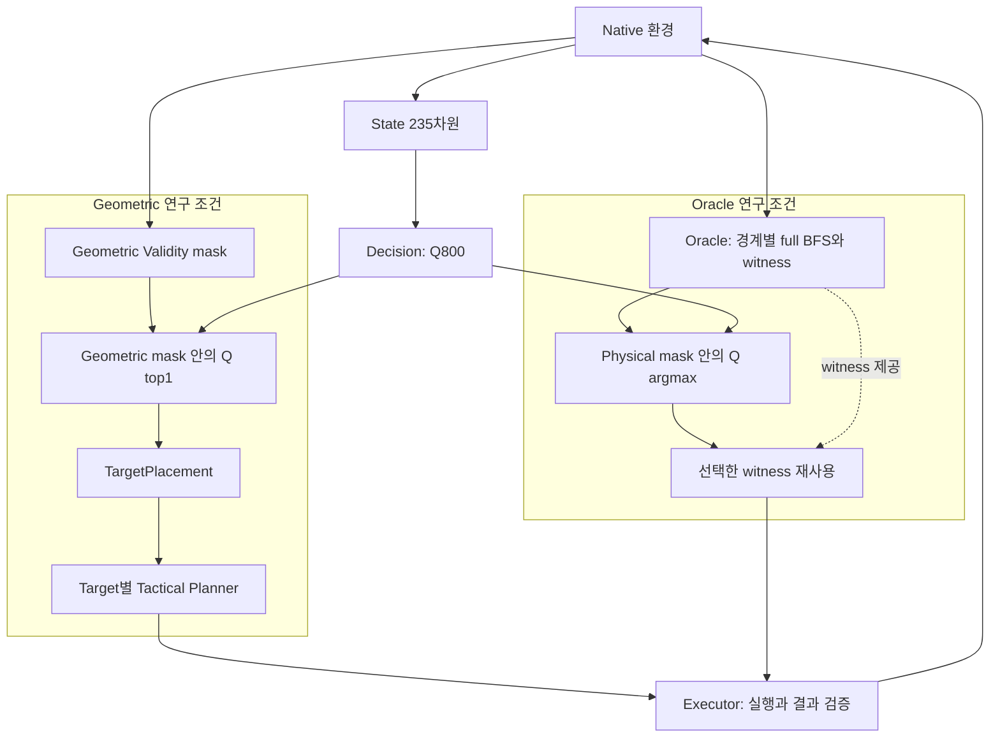

# Learning Without Game Heuristics

**수작업 게임 전략 휴리스틱 없이 강화학습 에이전트가 실행 가능한 의사결정과 게임 전략을 함께 학습할 수 있는지 탐구하는 프로젝트**다. 테트리스를 작은 실험 환경으로 사용하고 강화학습의 실패 원인을 실험과 기록으로 추적한다.

게임 전략은 수작업 보드 평가 함수 대신 DDQN으로 학습한다. 실제 이동·회전 입력 경로에는 BFS Planner를 사용하고, Geometric Validity 검사와 Oracle은 명시적으로 설계한 제약·탐색 구조다. 따라서 **시스템 전체가 휴리스틱이나 사전 설계 없이 작동한다는 주장은 하지 않는다**.

환경은 Maximilian Weichart의 오픈소스 `Tetris-Gymnasium 0.3.1`과 고지된 Viet Nguyen의 일부 game logic을 기반으로 한다. 원 MIT 출처·고지를 보존했고 render dtype 한 줄을 기존 연구 조건대로 수정했다. 공식 Tetris 브랜드와 제휴·승인된 프로젝트라는 의미가 아니다. Windows GUI 테멍은 별도 프로젝트다.

연구 코드·문서·Fixture와 직접 학습한 Checkpoint9개는 **MIT**로 제공한다. 원본 모델은 Git 이력에 넣지 않고 별도 Release Asset으로 배포한다. 모델이 없어도 새 학습을 실행할 수 있다. GUI·Windows EXE·아이콘·비공개 연구 원본은 이번 공개에 포함하지 않는다.

## 무엇을 연구했나

핵심 질문은 “Decision이 보드에서 기하학적으로 맞는 배치 가운데, Native 물리로 실제 실행할 수 있는 배치를 안정적으로 학습하는가?”이다. 이 문제는 **아직 해결됐다고 주장하지 않는다**.



두 연구 조건 중 하나를 선택한다. Geometric은 top1 목표를 고른 **뒤** Planner로 실행 가능성을 검사한다. Oracle은 경계의 full BFS로 physical mask를 만든 **뒤** 행동을 고르며, target별 재탐색 대신 같은 경계의 witness를 실행한다. Geometric 연구의 U self-loop와 관전용 fallback도 별도 모드다.

Decision은 배치 목표를 고른다. Tactical Planner는 실제 중력·회전·이동으로 목표에 도달하는 입력 경로를 탐색한다. Executor는 그 입력을 실행하고 결과를 검증한다. State는 잠긴 보드 200값과 현재·다음 4개 조각의 one-hot 35값, Action은 20×10×4=800개 고정 배치 슬롯이다. 중복 회전·범위 밖·충돌 슬롯은 mask로 제외한다.

Vanilla DQN과 Double DQN을 구현했고, 주요 후속 실험은 Double DQN이다. **Geometric Validity**는 보드에 겹치지 않고 지지되는 배치, **Physical Reachability**는 실제 입력 경로가 있는 배치다. 전자가 후자를 보장하지 않아 UNREACHABLE 선택이 환경을 바꾸지 않는 self-loop로 이어졌다. 고정 greedy 정책은 같은 목표를 반복할 수 있다.

## 결과와 한계

- Penalty −0.20은 paired 100K 실험의 후기 U 비율을 두 seed에서 약 23pp 낮췄지만, 약 68% U가 남았다.
- S1 feasibility head, S2 observed-U margin, S3 grouped-U, S4 fresh bootstrap은 분포·짧은 branch별 효과가 달랐다. 결합 500K에는 후기 붕괴도 있었다.
- Oracle Reachability Mask는 외부 BFS로 실행 가능성을 제공한다. Oracle seed42 2M의 별도 50-seed 최종 평가는 132.78 lines/1000 placements, 6.06 lines/episode였고 50/50 episodes가 사망 종료했다. 이것은 Decision의 실행 가능성 학습 성공이 아니다.
- 32-decision Smoke는 설치·실제 optimizer update·저장·재로딩의 기능 검증이다. 장기 학습 성능, 수렴, CUDA bitwise 재현, 정확한 resume를 인증하지 않는다.

[실험 비교와 해석](docs/experiments.md) · [연구 설계](docs/rl_pretraining.md) · [아키텍처](docs/architecture.md) · [한계와 다음 질문](docs/research.md) · [개발일지](docs/devlog.md)

## 시작하기: WSL2

Ubuntu 24.04 x86_64 / Python **3.12.10** 기준이다. Linux home의 새 디렉터리에 Clone한 뒤 실행한다. 정확한 설치·CUDA 선택·일반 학습 명령은 [WSL 가이드](docs/WSL_TRAINING.md)에 있다.

```bash
git clone https://github.com/HighKcal/Learning-Without-Game-Heuristics.git
cd Learning-Without-Game-Heuristics
python3.12 -c 'import sys; assert sys.version_info[:3] == (3,12,10)'
python3.12 -m venv .venv
source .venv/bin/activate
python -m pip install --require-hashes -r requirements/linux-cpu.lock
python -m pip check
python -B scripts/install_native.py
python -B scripts/validate_native_profile.py
python -B scripts/verify_wsl_runtime.py --device cpu
OMP_NUM_THREADS=1 MKL_NUM_THREADS=1 python -B scripts/smoke_train.py --device cpu --reachability-mask geometric --seed 123 --output-dir outputs/geometric_smoke_new
OMP_NUM_THREADS=1 MKL_NUM_THREADS=1 python -B scripts/smoke_train.py --device cpu --reachability-mask oracle --seed 123 --output-dir outputs/oracle_smoke_new
```

평가와 frozen 추론은 새로 학습한 Smoke 모델만으로 가능하다. 출력은 없는 새 경로를 사용한다.

```bash
OMP_NUM_THREADS=1 MKL_NUM_THREADS=1 python -B scripts/evaluate_policy.py --dataset evaluation/fixed_eval_final_v1 --checkpoint outputs/oracle_smoke_new/checkpoint_final.pt --device cpu --reachability-mask oracle --output outputs/oracle_eval_new.json
OMP_NUM_THREADS=1 MKL_NUM_THREADS=1 python -B scripts/play_agent.py --checkpoint outputs/oracle_smoke_new/checkpoint_final.pt --mode research --reachability-mask oracle --episodes 1 --max-decisions 6 --device cpu --output outputs/oracle_inference_new
```

## 직접 학습한 모델 9개

사용자는 pretrained 모델 없이 무작위 초기화에서 개인 PC로 DDQN을 학습했고 replay를 게임 환경에서 생성했다. 코드·payload가 이 설명에 부합하지만 과거 초기 weights·완전한 실행 provenance가 모두 저장된 것은 아니다.

| 실험 | Seed / 학습 budget | 배포 후보 |
| --- | --- | --- |
| Geometric baseline | 123 / 100K | final 1개 |
| Geometric penalty −0.20 | 42 / 500K | final 1개 |
| Oracle | 123 / 500K | periodic500K, final 2개 |
| Oracle | 42 / 2M | periodic300K/500K/1M/2M, final 5개 |

**9개를 개별 GitHub Release Asset으로 배포한다.** Source 공개 후 모델 Release 업로드·검증을 진행 중이며, 실제 Release가 게시되면 다운로드 링크를 추가한다. 원 bytes·역할·SHA256을 유지한다. [모델 목록](docs/models.md) · [모델별 설정·평가·한계](docs/MODEL_CARDS.md) · [Asset 이름/배치 경로/해시](MODEL_RELEASE_MANIFEST.json). 같은 budget의 final과 periodic은 다른 파일로 구분한다.

모델 Release 게시 후 신뢰된 공식 출처에서 9개 `.pt`를 한 다운로드 폴더에 모으고 소스 root에서 설치한다. helper는 manifest와 Registry의 목록·role·경로·size·SHA256을 모두 확인한 후 새 artifact root에 복사한다.

```bash
python -B scripts/install_model_assets.py --asset-dir ../downloaded-models --artifact-root ../model-artifacts
python -B scripts/validate_native_profile.py
OMP_NUM_THREADS=1 MKL_NUM_THREADS=1 python -B scripts/infer_agent.py --artifact-root ../model-artifacts --experiment oracle_mask.seed42.2m --role final --mode main_oracle_play_witness --device cpu --seed 100000 --limit 6 --output outputs/release_inference_new
OMP_NUM_THREADS=1 MKL_NUM_THREADS=1 python -B scripts/evaluate_policy.py --dataset evaluation/fixed_eval_final_v1 --checkpoint ../model-artifacts/runs/oracle_mask/seed_42/2m/checkpoint_final.pt --device cpu --reachability-mask oracle --output outputs/release_eval_new.json
```

`model-artifacts`와 출력은 없는 새 경로여야 한다. 지원 장치는 CPU다. [배포 절차](docs/MODEL_RELEASE_GUIDE.md), [신뢰 출처·PyTorch 로딩 보안](docs/CHECKPOINT_SECURITY.md)을 먼저 읽는다. `weights_only=True`와 SHA256 검사도 모든 위험을 제거하지는 않는다. 모델의 사용·수정·재배포·상업적 이용은 별도 [MIT 모델 LICENSE](MODEL_LICENSE.txt)에 따른다. Copyright·permission 고지를 유지한다. [모델 사용 조건](docs/MODEL_LICENSE_OPTIONS.md)

## Windows GUI 테멍

별도 GUI는 frozen 모델을 이용해 실행을 관찰하는 Windows 앱이다. V2.4.3의 빌드·추론·자동 GUI 검증은 기존 보고서에서 통과했으나 **공개 Beta는 NO-GO**다. 소스·모델·아이콘 권한과 Qt/MSVC/Intel 등 바이너리 재배포 조건, 새 Windows 검증이 남아 있다. [GUI 관계와 통합 계획](docs/gui.md)

## 프로젝트 구조

```text
src/tetris_agent/              연구 환경 어댑터·Planner·Executor·RL·추론
scripts/                      설치·검증·학습·평가·추론 CLI
tests/                        계약·물리·학습·Oracle 회귀 검증
experiments/                  81개 보존 맥락의 Registry와 Native profile
requirements/                 CPU 30 / CUDA 49 wheel 해시 lock
vendor/native_tetris_031/      수정 Native Python 19개·원 MIT 고지
evaluation/fixed_eval_final_v1/ 선별 256-state 평가 fixture
docs/                         한국어 연구 문서·공개용 DEVLOG·결과 집계
PUBLIC_ALLOWLIST.txt           공개 후보 파일의 명시 목록
```

81 records는 독립 학습 81회를 뜻하지 않는다. 80개 run/context와 logical S2 sequence 1개다. 전체 Canonical, 비공개 분석, 과거 worktree, runtime, Git/LFS 이력은 포함하지 않는다.

## 라이선스와 출처

사용자 보유 연구 코드·문서·Fixture는 [MIT LICENSE](LICENSE), 직접 학습한9개 모델은 별도 [MIT MODEL_LICENSE](MODEL_LICENSE.txt)를 적용한다. Copyright (c) 2026 HighKcal. 범위와 감사 근거는 [권리·공개 문서](docs/licensing.md)에 있다. 원 Native의 MIT LICENSE와 Maximilian Weichart / Viet Nguyen attribution은 보존했다. [제3자 고지](THIRD_PARTY_NOTICES.md). Native 상류 고지가 프로젝트 수정분·모델·GUI 자산 전체의 배포 승인을 대신하지 않는다.

[Phase 4.5 최종 감사](PHASE4_5_RESEARCH_MODEL_RELEASE_AUDIT.md) · [사용자 승인 목록](docs/RELEASE_APPROVALS.md) · [Phase 4 준비 기록](docs/PHASE4_GITHUB_PUBLIC_PREPARATION_REPORT.md)
