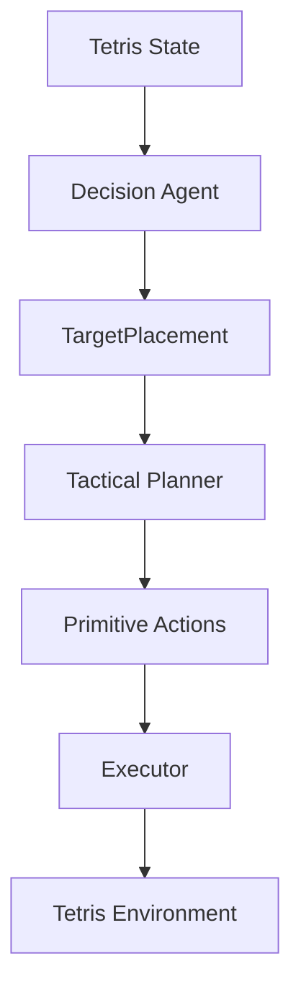

# 테멍 — 연구 개발일지 (공개용 사본)

> 공개용 사본: 2026-10-14. 내부 원본은 별도 보존하며 Section 1~55·Takeaway·부록과 수치를 유지했다. 로컬 경로만 별칭으로 치환했다. E01~E36의 비공개 증거는 [근거 안내](evidence.md)에 출처 종류·해시·비공개 상태를 기록하며, 원본 파일을 제공하는 링크가 아니다. 역사적인 영문 제목은 원문의 식별을 위해 유지한다.

> **Current Status — 2026-10-13 기준**
>
> 원래 질문인 Decision의 안정적인 실행 가능성 학습은 해결됐다고 판정하지 않았다. Penalty/S1~S4의 부분 개선과 장기 실패, Oracle 조건의 전략 개선 및 후기 정체를 Section 35~50에 기록했다. Geometric Play fallback과 Oracle Witness는 외부 search를 사용하는 서로 다른 실행 정책이다.
>
> 연구 소스는 Phase 2 통합과 후속 Phase 3 환경 검증이 반영된 상태다. [Phase 2 통합 보고서](evidence.md#e34), [Phase 3 WSL 검증 보고서](WSL_REPRODUCIBILITY_REPORT.md)에서 확인된 범위를 따른다. WSL의 CPU/CUDA 짧은 학습 smoke와 기존 CPU 궤적 검증은 **환경 기능 검증**이며, 새 연구 성능·장기 학습 재현성·CUDA exact resume의 완료를 뜻하지 않는다. Registry의 frozen inference 지원은 여전히 4개 실험/9개 체크포인트의 CPU 계약이다.
>
> 원본 `[원본 연구]`은 기존 main이며 통합 소스 전환·GitHub 공개는 완료하지 않았다. 아래 Section 1~34 및 Takeaway, 그 안의 `Current`와 2026-10-08 상태 메모는 작성 당시 기록을 보존한다. 최신 상태가 그 역사적 문구를 대체한다. 상단 연구 개발 Phase 0~7과 후속 감사·환경 검증 Phase 1~3은 서로 다른 단계명이다.

## 0. Project Overview
이 문서는 Tetris 자동 플레이 에이전트 개발 과정, 설계 결정, 그리고 구현 중 발견된 문제들을 기록한 기술 일지다. 이 프로젝트의 목표는 단순히 게임을 잘하는 프로그램을 만드는 것이 아니라, 실제로 학습하는 Agent를 밑바닥부터 구축해 보고 Decision(의사결정)과 Physical Execution(물리적 실행)을 분리하여 Search와 RL을 하나의 architecture에서 연결하는 것이다.

특히 프로젝트를 관통하는 핵심 연구 질문(Research Question)은 다음과 같다:
> **전술적 실행을 Search Planner에 맡겼을 때, 강화학습 Decision Agent가 좋은 배치 전략뿐 아니라 실제로 도달 가능한 Target을 선택하는 능력까지 시행착오를 통해 학습할 수 있는가?**

(작성 당시 메모 — Section 34 시점: RL infrastructure 최적화 및 10K integration 검증을 마친 뒤 100K 학습·failure diagnosis와 penalty ablation을 진행 중이었다. 이 문장의 상태는 아래 후속 기록 이전의 역사적 상태다. 현재 판정은 문서 상단과 Section 55를 참고한다.)

## 1. Phase Summary
전체 프로젝트 발전 과정을 빠르게 복기하기 위한 요약 타임라인이다.
- **Phase 0 — Project exploration**: 게임 / 학습 실험 후보 탐색
- **Phase 1 — Environment reconnaissance**: Tetris-Gymnasium 동작 분석
- **Phase 2 — State / Target abstraction**: TargetPlacement, Validity 설계
- **Phase 3 — Action Space**: 1728 → 800 → edge regression → coordinate redesign
- **Phase 4 — Tactical Planning**: BFS / visited / auto-lock
- **Phase 5 — Execution**: verified Executor
- **Phase 6 — Random Decision**: E2E smoke-test pipeline 검증
- **Phase 7 — Current**: 첫 100K Training 실행 및 Failure Diagnosis (Penalty Ablation 진행 중)

> **Current-status note (2026-10-08)**:
> 아래 Overview 및 Phase Summary 일부는 작성 당시의 historical state를 보존한 것입니다.
> 이후 Penalty Ablation, S1–S4 intervention, Oracle Reachability Mask, long-horizon training 및 후속 분석을 거쳐 Research v1은 종료되었습니다.
> 현재는 clean staging, training runtime 분리, GUI/productization 단계에 있습니다.
> 최신 chronology는 Section 35 이후를 참고하십시오.

## 2. Pre-Tetris Exploration (How the Project Became a Tetris Agent)
초기부터 Tetris를 목표로 삼았던 것은 아니다. 가장 큰 동기는 단순히 API를 호출하는 프로젝트가 아니라, 직접 모델을 만들고 Transformer의 학습/추론, Quantization 같은 AI 주제를 다뤄보는 것이었다.

이 과정에서 DOOM 같은 3D 게임이나, "앞에서 나온 정보를 기억하면서 새로운 정보가 주어지는" Sequence/Memory 게임도 검토했다. Transformer의 메모리 처리 능력을 보여줄 수 있을지 고민했으나, 환경 구현에 너무 많은 시간을 쏟게 될 우려가 있었고, 짧은 MVP 기간 내에 실제 학습 결과를 얻어낼 수 있는 환경이 필요했다.

결국 이미 검증된 환경이 존재하고, State/Action/Reward가 명확하며, 의도했던 대로 "전략적 선택과 물리적 실행"을 분리하여 Agent 구조를 실험하기에 Tetris가 가장 적합하다고 판단하여 프로젝트 범위가 구체화되었다.

## 3. Architecture Direction
게임 선택과 Agent 구조를 고민하는 과정에서, "전략적 의사결정과 물리적 실행을 분리하는 방향"이 프로젝트의 핵심 설계 원칙으로 발전했다.

학교에서 배운 AI Agent 개념(환경을 percept하고 actuator로 변화시킨다)을 프로젝트 구조에 연결해 보면서 책임이 다음과 같이 나뉘게 되었다:

- **Decision Agent**: 전략적 선택 (WHAT / WHERE). "어떤 최종 배치를 선택할 것인가"
- **Tactical Planner**: 물리적 도달 경로 계산 (HOW). "실제 환경에서 그 배치까지 어떻게 갈 것인가"
- **Executor**: 실제 환경 변화 (DO). "Planner의 명령을 실제 환경에 실행하고 검증"

### Key Design Decisions
빠른 복기를 위해 주요 설계 결정을 표로 정리했다.

| Topic | Decision | Alternative / Deferred | Why |
|---|---|---|---|
| **Environment** | Tetris-Gymnasium 0.3.1 | 직접 게임 환경 구현 등 | 환경 구현 자체보다 Agent/학습 구조에 집중하기 위함 |
| **Agent output** | TargetPlacement | primitive action 직접 선택 | 전략(strategy)과 전술적 실행(tactical execution) 분리 |
| **Target state** | (x, y, absolute orientation) | rotate N times | 배치의 최종 결과를 명확하게 고정 |
| **Action representation**| fixed discrete 800 slots | x/y/orientation separate, variable candidate scoring | 첫 RL 구현의 단순화 및 안정적인 action semantics 확보 |
| **Hold** | MVP 제외 | Hold-aware decision | 핵심 파이프라인 완성을 위한 Scope control |
| **Reachability mask** | 제공하지 않음 | reachable targets만 Agent에 제공 | RL 모델이 reachability avoidance(물리적 도달 불가 회피)까지 스스로 학습하는지 실험하기 위함 |
| **Planner** | BFS v0.01 | A* | 디버깅, 정확성, 검증, 그리고 이해의 용이성 우선 |
| **Sequence pruning** | v0.01에서 보류 | target 방향 L/R pruning | 장애물 회피 등 실제 reachable path가 삭제될 위험성 |
| **HARD_DROP** | 일반 BFS action에서 제외 | search action에 포함 | Planner와 Executor의 명확한 역할(goal probe용) 분리 |
| **Executor** | execution verification 포함 | 단순 action replay | early-lock 등으로 인한 다음 piece 오조작 방지 |
| **Planner optimization**| End-to-End 측정 이후 | 즉시 최적화 | 실제 병목을 측정하기 전 premature optimization 방지 |

## 4. Environment Reconnaissance
Agent 구현에 앞서, 선택한 환경인 `Tetris-Gymnasium 0.3.1` 자체를 먼저 분석했다.
확인된 환경 특성은 다음과 같다:
- **Action Space**: Discrete(8) (LEFT, RIGHT, DOWN, ROTATE_CLOCKWISE, ROTATE_COUNTERCLOCKWISE, HARD_DROP, SWAP, NO_OP)
- **Board**: 내부 padded board 24×18, 실제 playable board 20×10.
- **Gravity**: 한 step에서 action 이후 gravity가 적용된다. (예: DOWN은 explicit drop + gravity로 2칸 이동 가능)
- **Mechanics**: SRS나 Wall kick이 없고, Lock delay도 없다. 회전은 `np.rot90` 기반이다.
- Game over는 spawn collision을 기반으로 발생하며, get_state()/set_state() 및 headless 실행이 가능하다.

이 조사는 Planner가 물리 규칙을 자체적으로 재구현하는 대신 실제 `env.step()`을 transition model로 사용하기로 결정하는 핵심 근거가 되었다.

## 5. Defining State and TargetPlacement
### Observation board 해석 충돌과 해결
초기 조사에서는 `observation["board"]`에 active falling piece가 포함되지 않는다고 오해했으나, 교차 검증 결과 `project_tetromino()`를 통해 active piece가 합성됨을 확인했다. 반면, `env.unwrapped.board`는 locked blocks만을 포함한다.
Decision state와 Target validity 판단 시 active piece를 기존 장애물로 오인하지 않기 위해, locked board만을 제공하는 `env.unwrapped.board`를 사용하는 것으로 확정했다. 이 과정에서 source code와 실제 array comparison을 거치고 regression test를 통해 의미를 고정했다.

### Decision State 방향
당시 Neural Decision Agent와 DQN 인프라가 처음 구현되었을 때는 실제 학습 성능이 검증되지 않은 상태였다. 초기 설계 의도대로 전략적 판단을 위해 "locked board", "current piece", 그리고 "visible future queue 전체"를 입력으로 사용하며, 블록 스폰 직후(canonical spawn state)에 호출된다. Hold는 제외된다.

### TargetPlacement 설계
Decision Agent가 직접 primitive action을 고르는 대신 `TargetPlacement(x, y, orientation)`를 선택하도록 설계했다. 여기서 `orientation`은 "몇 번 회전하라"가 아닌 "최종 absolute orientation"을 의미하며, `TargetPlacement`는 공중 상태가 아닌 resting placement를 나타낸다.

## 6. Validity vs Reachability
프로젝트의 핵심 설계 결정 중 하나는 "기하학적 유효성(Geometric Validity)"과 "물리적 도달 가능성(Physical Reachability)"을 의도적으로 분리한 것이다.
- **TargetSpace (Validity)**: 배치 자체가 기하학적으로 정상인지(보드 내부, 겹침 없음, 바닥 또는 다른 블록 위에 안착함) 판단한다.
- **Tactical Planner (Reachability)**: 현재 상태에서 실제 primitive action으로 이 Target에 도달할 수 있는지 판단한다.

따라서 VALID하지만 UNREACHABLE한 Target이 존재할 수 있다. RL Agent가 도달 불가능한 선택을 스스로 피하는 법을 학습할 수 있는지 실험하기 위해, Decision Agent에게 reachability mask를 미리 제공하지 않는 방향을 유지했다.

## 7. Designing the Fixed Action Space
RL Agent가 행동을 선택하는 방법으로 1) x/y/orientation 개별 출력, 2) fixed discrete Action ID, 3) Candidate scoring 방식을 고려했으나, 구현이 비교적 단순하고 DQN 구조와 연결하기 쉬운 2번(Action ID) 방식을 MVP로 채택했다.

### 7.1 Initial 1728-slot design
초기에는 24×18 크기의 전체 내부 보드에 대해 4개의 orientation을 곱해 1728개의 action slot을 부여했다.

### 7.2 Reducing to 800
기능적으로는 동작했으나 padding/wall 구역 등 절대 선택될 수 없는 action에 ID를 부여하는 것은 불필요하다고 판단, 실제 playable logical coordinate만 사용하는 800개 (20×10×4)의 slot으로 축소했다.

### 7.3 Edge-placement regression & 7.4 Logical bounding-box coordinates
800 slot으로 축소하는 과정에서 심각한 버그를 발견했다. 처음에 raw matrix origin 기준으로 좌표를 제한했더니, 세로 I piece와 같이 내부 blank padding 때문에 실제 occupied cell이 playable x=4부터 시작함에도 불구하고 valid edge placement가 Action Space에서 누락되었다.
이를 해결하기 위해 Target의 좌표계를 `occupied cells bounding box`의 좌상단(logical coordinate)으로 재설계했다. `env_origin_to_target`과 `target_to_env_origin` 변환을 도입하여 내부의 빈 공간을 추상화함으로써, 800개의 고정 슬롯을 유지하면서도 모든 유효한 배치를 정상적으로 표현할 수 있게 되었다.

### 7.5 Independent coverage testing
초기의 `action_id ↔ TargetPlacement` round-trip 테스트는 내부 일관성만 검증할 뿐, 환경의 실제 가능한 모든 placement가 표현되는지는 보장하지 못했다. edge-placement 버그를 계기로, 실제 matrix를 사용한 독립적인 reference placement 집합과 TargetSpace의 반환값을 비교하는 independent coverage test를 추가하여 교차 검증을 수행하도록 테스트 철학을 강화했다.

## 8. Tactical Planner v0.01
### 8.1 Why BFS
TargetPlacement에 도달할 수 있는지 판단하고 경로를 반환하는 Tactical Planner는 첫 버전으로 BFS 알고리즘을 선택했다. 이해와 검증이 쉽고 shortest sequence를 보장하며, `get_state()`와 잘 호환되기 때문이다.

### 8.2 Real environment transitions
Planner가 게임의 물리 엔진을 별도 구현하지 않고 `env.unwrapped.step()`을 직접 transition으로 사용하여 100% 환경과 일치하는 시뮬레이션을 수행한다.

### 8.3 visited vs sequence pruning
탐색 최적화 논의 중, "exact duplicate state (visited)" 문제와 "L/R 왕복 같은 불필요한 시퀀스 (sequence pruning)" 문제가 분리되어야 함을 확인했다. 이 환경에서는 gravity 때문에 좌우 왕복 후에도 y 좌표가 달라져 서로 다른 물리적 상태가 된다. L/R이나 회전 시점을 제한하면 장애물 밑으로 피하는 복잡한 경로(tuck under)를 찾지 못할 수 있으므로, v0.01에서는 hard sequence pruning을 적용하지 않고 exact duplicate만 visited로 처리하기로 결정했다.

### 8.4 HARD_DROP goal probe & 8.5 Auto-lock
초기에는 마지막에 무조건 HARD_DROP을 수행한다고 보았으나, 검증 과정에서 primitive action 직후 gravity로 인해 piece가 환경 바닥에 자동 고정되는 "Auto-lock" 현상을 발견했다. 이에 따라 PlannerResult에 `needs_hard_drop` 필드를 추가하여, 탐색 중 auto-lock으로 목표에 도달했는지 아니면 마지막에 명시적인 HARD_DROP이 필요한지를 Executor에게 전달하도록 보완했다.

### 8.6 Planner validation and performance
수동 검증 결과, O direct drop, auto-lock, sealed cavity (UNREACHABLE), 장애물 밑으로 들어가는 복잡한 tuck maneuver까지 정확히 탐색함을 확인했다. 성능은 수십 ms에서 복잡한 실패 경로의 경우 약 550ms 수준이 측정되었으나, v0.01에서는 정확성을 최우선으로 하고 성능 최적화는 실제 End-to-End 성능 병목을 확인한 뒤로 미루었다.

## 9. Executor v0.01
### 9.1 Why an Executor exists
Planner의 경로를 단순히 `env.step()` 루프로 전달하는 대신, 다음 piece를 조작할 위험을 막기 위해 검증 기능을 갖춘 Executor를 구현했다.

### 9.2 Execution verification & 9.3 Auto-lock safety
만약 환경 예상과 달리 일찍 lock이 발생하면 남은 행동(예: HARD_DROP)이 다음 피스에 적용될 수 있다. Executor는 매 step마다 native placement 이벤트를 감시하고, 계획보다 조기에 lock이 발생하면 남은 행동을 중단(EARLY_LOCK)한다. 반대로 `needs_hard_drop=False`라면 예정된 auto-lock을 준수하며 추가적인 드롭을 막는다.

### 9.4 Failure detection
Executor는 실패 상황에서 복구나 재계획을 시도하지 않고 즉각 상위로 보고한다.
- `UNREACHABLE`
- `EARLY_LOCK`
- `PLAN_DIVERGED`
- `TARGET_MISMATCH`
- `TRANSITION_ERROR`

주목할 점은 최종 lock은 성공적이었으나 그 결과로 Game Over가 발생한 경우, 이를 실행 실패가 아닌 `target_verified=True`, `terminated=True`로 분류한다는 점이다. 이는 향후 RL에서 "물리적 제어 실패"와 "전략적으로 나쁜 선택"을 구분하기 위함이다.

### 9.5 Executor validation
수동 검증과 자동화 테스트를 통해 의도된 lock, 조기 lock 거부, 게임 종료 상태 반환 등의 기능이 187개의 테스트 통과와 함께 입증되었다.

## 10. Testing Strategy Evolution
기능을 구현하고 설계 결정을 내리면서 테스트 커버리지가 단계별로 강화되었다.
- 초기 기반: 57 passed
- Action Space / board regression 보강: 63 passed
- coordinate semantics + independent coverage: 113 passed
- Planner 개발: 152 passed
- Executor 개발: 187 passed
- Random Decision / E2E phase: 215 passed
- Planner v0.02 Performance Pass 통합 후: 289 passed

단순히 테스트 개수가 목표가 아니라, 버그(vertical I edge)와 설계 충돌(board definition)을 거치며 각 계층의 독립성을 검증하는 방향으로 진화했음이 중요하다.

## 11. Key Learnings & Takeaways
개발 과정에서 직면했던 기술적 문제들과 교훈들이다.

- **Environment investigation**: 외부 라이브러리의 observation 이름만 보고 의미를 추측하면 안 되며, source code 열람, 런타임 실험, 그리고 regression test를 결합한 확인이 필수적이었다.
- **Action Space**: 게임 엔진 내부 좌표계(raw origin)와 Agent가 보는 논리 좌표계(bounding box origin)는 반드시 동일할 필요가 없으며, 올바른 abstraction boundary 설정이 문제 해결의 핵심이었다.
- **Testing**: 입출력을 단순히 주고받는 round-trip test가 통과한다고 해서 실제 상태 커버리지가 보장되는 것은 아니며, 구현과 독립적인 reference test가 얼마나 중요한지 버그 수정을 통해 배웠다.
- **Planner**: "중복 state 제거"와 "의미 없어 보이는 sequence pruning"은 성격이 다른 문제다. 최적화를 너무 일찍 시도하면 tuck maneuver 같은 유효한 동작 공간(completeness)을 잃을 수 있다.
- **Executor**: Planning 성공과 실제 Execution 성공은 별개다. 실행 계층을 독립적으로 분리함으로써 early-lock이나 target mismatch를 명시적으로 검증하고 안전하게 처리할 수 있었다.
- **Development process**: 처음에 아이디어를 넓게 탐색한 후, MVP 단계에서는 과감하게 scope를 줄인 것이 실제 구현 진척에 큰 도움이 되었다. 성능 최적화 역시 실제 workload 측정 전까지 미루는 것이 적절했다.

## 12. Deferred Experiments (Scope Decisions)
MVP 완성을 위해 다음 항목들은 폐기(abandoned)된 것이 아니라, 의도적으로 유보(deferred)되었다.
- Hold / SWAP 기능 (초기 검토 완료, 복잡도 제어로 미룸)
- Planner의 A* 알고리즘 전환, aggressive sequence pruning, 병목 최적화
- Variable candidate scoring 등 더 유연한 Action Space 방식 도입
- Neural Planner / Imitation Learning 적용
- FP32 vs INT8 Quantization 성능 및 학습 차이 실험

## 13. Git Milestones
개발 과정 중 처음으로 Git을 도입하여 버전을 관리하기 시작했다.
현재 local Git repository에서 다음 milestone commit을 시작했다.
- `ebfa2bd` : feat: add core Tetris environment and BFS tactical planner
- `a032006` : feat: add verified Tetris executor
- `fe12e63` : docs: add project development log
- `752fbac` : feat: add random decision end-to-end game runner
- `f961818` : perf: avoid duplicate child snapshots in tactical planner
- `4578ded` : perf: skip unused observations in tactical planner
- `aded5ba` : docs: record planner performance pass
- `364dc4c` : feat: add DQN training pipeline and pre-training hardening
- `b7b387`  : perf: unbelievably cut learner update time from 1.68s to 9ms
- `607d30d` : feat: make unreachable penalty configurable

현재 repository에 benchmark / scratch / exploratory 성격의 untracked 파일들이 다수 존재하지만, 주요 설계와 기능은 위 milestone을 기준으로 관리/봉인되고 있다.

## 14. Current Architecture
현재 구현된 시스템:
- Environment Adapter
- TargetSpace (Fixed 800 Action Space)
- Coordinate Conversion (Logical bbox coordinates)
- Geometric Validity checker
- Tactical Planner v0.02 (BFS semantics 유지, duplicate child snapshot 제거 + unused observation 생성 우회)
- Executor v0.01 (Execution verification, early-lock prevention)
- Random Decision smoke path
- RLRunner & DQNTrainer (Vanilla DQN / Double DQN)
- Reward system (Minimal / Shaped)
- Replay Buffer & Training orchestration
- Durable run artifacts & Production CLI

구현되지 않은 시스템 (Deferred / Next phase):
- Hold-aware Decision
- PER, Dueling, n-step, CNN, PPO
- Exact-resume checkpointing
- Quantization (FP32 vs INT8)
- Final fixed evaluation tooling (구축 완료 - Frozen)

## 15. Current Limitations
- Planner v0.02에서 주요 observation/snapshot overhead를 제거했지만, native state copy, collision check, transition simulation 자체의 비용은 남아 있으므로 대규모 RL rollout 중 계속 계측한다.
- RL infrastructure correctness와 10K smoke integration test는 완료되었고 첫 100K 학습도 실행되었으나, late training degradation 현상이 발견되어 policy quality 및 reachability learning 실패 원인을 진단 중이다.
- Hold를 처리하지 못하는 제약 (Exact-resume 불가 등 시스템적 한계 포함).

## 16. Next Steps (Updated)
RL 인프라 구현이 완료됨에 따라 구체적인 향후 실험 계획은 문서 최하단의 **Next Steps (Empirical RL Timeline)** 으로 통합되었다.

## 17. Random Decision / End-to-End Smoke Test (2026-10-03)

- RandomDecisionAgent는 geometric valid IDs/mask만 받아 action_id와 TargetPlacement를
  반환한다. owned random.Random(seed), 안정적인 후보 순서, global RNG 비간섭을 검증했다.
- GameRunner는 Adapter → geometric mask → random choice → Planner → Executor를 반복한다.
  reachability prefilter는 없으며 UNREACHABLE을 실제 선택/계측한다. 같은 turn의 실패 ID는
  제거하고 모든 unique 후보를 소진하면 ALL_VALID_TARGETS_UNREACHABLE로 종료한다.
  retry 상수, fallback, 실행 실패 뒤 복구는 없다. 이 재추첨은 smoke-test 전용이며 RL 정책이 아니다.
- 성공한 Executor placement만 pieces_placed로 집계한다. 성공 lock 후 terminated는 정상
  game over이며 실제 Executor failure와 구분한다. 실패 reason, 종료 flags, attempt 기록을 보존한다.
- 0.3.1 source에서 step.info의 lines_cleared가 native clear_filled_rows의 실제 제거 수임을 확인했다.
  실제 Executor 호출 중에만 그 반환값을 관찰한다. 따라서 가상 Planner clear를 제외하고,
  clear 후 wrapper 예외로 info가 반환되지 않아도 실제 line 수를 보존한다. reward mapping은 없다.
- 기존 PlannerResult.elapsed_seconds를 재사용하여 모든 호출의 avg/max/nearest-rank p95를
  계산한다. Planner/Executor/TargetSpace 동작 의미 및 알고리즘은 변경하지 않았다.

서로 다른 seed 조합 3개를 scripts/run_random_game.py로 종료까지 실행했다.
아래 시간은 동시 실행의 자원 경합을 피한 **순차 실행** 측정값이며 하드웨어/부하에 따라 변한다.

| Env / Decision seed | Pieces | Lines | Decisions | UNREACHABLE | Rate | Executor failures | Planner avg / p95 / max (ms) | Duration (s) | Stop |
|---|---:|---:|---:|---:|---:|---:|---|---:|---|
| 42 / 42 | 13 | 0 | 15 | 2 | 13.3% | 0 | 84.720 / 362.620 / 362.620 | 1.466 | TERMINATED |
| 7 / 19 | 22 | 0 | 51 | 29 | 56.9% | 0 | 49.819 / 357.662 / 559.913 | 2.865 | TERMINATED |
| 123 / 456 | 19 | 0 | 30 | 11 | 36.7% | 0 | 14.196 / 91.650 / 114.526 | 0.719 | TERMINATED |

3게임 모두 실제 UNREACHABLE이 발생했고 Executor failure는 없었다.
일반 random game의 line clear는 모두 0이었다. controlled scenario에서는 1/2행 clear,
auto-lock clear, clear 이후 wrapper 예외를 검증했다. 최적화 판단이나 구현은 하지 않았다.

검증: 기존 baseline 187 passed를 확인하고 신규 테스트 28개를 추가했다.
최종 `.\.venv\Scripts\python.exe -m pytest -q`: **215 passed in 7.60s**.
`.\.venv\Scripts\python.exe -m pip check`: **No broken requirements found.**

## 18. RL Decision Agent Design (Pre-Training Phase)

### 18.1 RL Study and Algorithm Research
이번 Phase에서는 바로 코드를 짜기 전에, RL의 기본 개념(State, Action, Reward, Q-value, Bellman equation, Replay Buffer, Target Network, epsilon-greedy, Double DQN 등)을 우선적으로 복기하고 알고리즘을 조사했다.

이론 학습 후, **Vanilla DQN → Double DQN**을 첫 방향으로 결정했다.
- **왜 DQN인가?**: 프로젝트 특성 상 Action Space가 800개로 고정되어 있고, 한 번의 Transition을 생성하기 위한 Planner 호출 비용이 상당하다. 따라서 비싸게 수집한 경험을 Replay Buffer에 저장하여 여러 번 재사용할 수 있는 Off-policy 방식인 DQN 계열이 첫 알고리즘으로 더 적합하다고 판단했다.
- **왜 PPO가 아닌가?**: Maskable PPO 등 Policy-gradient 기반 알고리즘도 800 Action과 Masking 구조에서 사용할 수 있다. 하지만 On-policy 특성상 지속적으로 새로운 rollout을 수집해야 하므로, 샘플 생성 비용이 높은 현 시점에서는 첫 모델로 덜 매력적이었다. PPO는 향후 교차 비교(cross-family comparison)를 위해 남겨둔다.
- **왜 Vanilla DQN을 유지하는가?**: DQN에서 발생하는 Max-induced overestimation을 방어하는 Double DQN을 메인으로 삼지만, 800-action TargetPlacement라는 특수 환경에서 Bellman next-action target calculation 변경이라는 **단 하나의 차이(Ablation)**만을 두고 Vanilla와 Double의 성능을 명확히 비교하기 위해서다.

### 18.2 State and Network v1 설계
**State v1**:
- locked board 20×10 (200차원)
- current piece type (7-way one-hot)
- visible next 4 queue (7-way one-hot × 4)
총 235차원이며, Hold와 현재 블록의 물리적 위치(x, y, orientation)는 제외했다. Decision Agent는 블록 스폰 직후(Canonical Decision Point)에만 호출되며, UNREACHABLE 시에도 상태 변화 없이 재호출되므로 물리적 위치가 중복된(redundant) 정보라고 보았기 때문이다. 이 상태가 장기 미래의 100% full-Markov state라고 주장하지는 않지만, 도달 가능성 판단 및 전략 수립에 필요한 physical information은 충분하다고 판단한다.

**Network v1**: `Linear 256 → ReLU → Linear 256 → ReLU → Linear 800 (Q-values)`
첫 베이스라인은 단순 MLP로 결정했다. Board를 flatten 한다고 해서 각 셀의 고유 위치(identity)가 삭제되는 것은 아니며, 단지 CNN과 같은 spatial inductive bias가 없을 뿐이다. 데이터로 관계를 학습하는 데 한계가 있는지부터 확인하고, 추후 CNN과 비교하기 위한 기준점이다.

### 18.3 Action, Reachability Semantics, and Formal Random
- **Masking**: Geometric-invalid 액션은 반드시 다음 세 곳 모두에 일관되게 마스크 처리된다: 1) epsilon random exploration, 2) greedy action selection, 3) Bellman bootstrap의 next-action selection (Vanilla DQN은 masked next-state max, Double DQN은 Q_online에서 masked argmax 후 해당 action을 Q_target에서 평가). 반면 **Physical UNREACHABLE 액션은 Agent에게 절대 마스크로 알려주지 않는다.**
- **UNREACHABLE RL Semantics**: Agent가 UNREACHABLE 액션을 선택하면 Executor는 아무것도 실행하지 않으며, 환경은 변하지 않는다(S' = S). Minimal Reward 기준으로 음의 보상(penalty)을 받고 이 `(S, A, -0.05, S)` self-loop Transition은 그대로 Replay Buffer에 들어간다. Agent가 시행착오를 통해 스스로 해당 가치를 낮추도록 하는 것이 본 연구의 목표다.
- **Formal Random Baseline**: 초기 Smoke Test의 Random 러너는 UNREACHABLE 발생 시 재추첨을 했지만, RL 성능 평가를 위한 Formal Random Baseline은 RL과 동일하게 UNREACHABLE 시 페널티를 받고 동일 State에서 다시 판단(self-loop)하도록 엄밀하게 분리했다.

### 18.4 Planner Failure Classification
RL 학습 중 Planner의 실패를 명확히 구분하여 처리한다. 이 구분은 Correctness Requirement로 둔다:
- **PHYSICAL_UNREACHABLE**: RL 패널티 제공 (Agent의 잘못된 판단)
- **SEARCH_TIMEOUT / UNKNOWN**: Planner가 결론을 내지 못한 것으로, RL 패널티 없이 무시(학습 제외)
- **EXECUTION_ERROR**: 시스템/구현 오류로 RL 패널티 없이 무시(학습 제외)

### 18.5 Reward Design & PBRS 정정 사항
최소한의 목표인 **Minimal Reward**와 쉐이핑이 추가된 **Shaped Reward**를 별도로 비교 실험한다.

**Minimal Reward**:
`r_minimal = L - 0.05*U - D`
- 라인 클리어(L): +1 ~ +4
- UNREACHABLE(U): -0.05 Base Penalty
- Game Over(D): -1

**Shaped Reward**:
`r_shaped = L - 0.05*U - D + 0.99 * Phi(s') - Phi(s)`
- `Phi(s)`는 실제 게임 종료(actual terminal) 상태에서는 `0`, 그 외에는 `-0.25 * h / (h + 10)` (h: locked board hole count)이다.

- **PBRS Self-loop 정정**: 초기 설계 리뷰(Independent Audit)에서 "S'=S이므로 PBRS shaping term = 0이다"라고 잘못 판단하는 일이 있었다. 그러나 후속 검토(Review)를 통해 PBRS 공식 `F(s,s') = gamma * Phi(s') - Phi(s)`에 따라 S'=S라 하더라도 `(gamma - 1) * Phi(s)`이고 gamma=0.99이면 일반적으로 0이 아님을 재확인했다. Audit의 해석 오류를 수정한(Correction) 이 과정을 통해 미세한 양의 보상 쉐이핑이 생김을 명확히 하고 기존 설계를 유지했다.
- **Scale 0.25의 이유**: 처음 구멍 1개가 생길 때의 페널티 크기를 UNREACHABLE 베이스 페널티(-0.05)보다 작게(약 -0.0225) 유지하기 위한 보수적인 시작값이다.

### 18.6 Replay v1 & Terminal vs Truncated
- **Replay**: State는 float이나 one-hot이 아닌 원본 semantic representation (uint8 보드, 정수 피스 ID) 형태로 저장해 공간을 절약하고 네트워크 입력 직전에 변환한다.
- **Terminal vs Truncated**: Game Over 시점(`terminated=True`)에는 Q-Bootstrap을 끊고 `Phi=0`을 적용한다. 그러나 시뮬레이션 한계 초과 등(`truncated=True`)으로 강제 종료될 경우 Game Over 페널티를 주지 않으며, Bootstrap을 유지한다.

### 18.7 RL v0.01 Spec Freeze & Evaluation Plan
- **Spec**: Algorithm: Vanilla DQN baseline / Double DQN main. Core: 1-step, uniform replay, target network, epsilon-greedy, geometric-only mask. Optimizer: Adam (1e-4), Loss: Huber Loss, Gamma 0.99, Capacity 100K, Batch 128, Learning Starts 5K, UTD Ratio 1:1 (1 decision : 1 update), Target Sync 5,000 gradient updates (hard sync), Epsilon 1.0→0.05 (decay는 post-warmup budget의 약 40%), Gradient clipping: max norm 10. (PER, Dueling, n-step은 off). 이 값들은 이론적 "최적값"이 아니라, 통제된 실험을 위한 "초기 기준(baseline configuration)"이다.
- **Evaluation Plan**: 단순 에피소드 중 UNREACHABLE 비율은 State 분포 변화 때문에 해석이 어려울 수 있다. 따라서 학습과 별개로 Offline Planner로 라벨링(reachable/unreachable)된 **Fixed Evaluation State Set**을 구축하고, Agent의 greedy choice가 reachable인지(fixed-state greedy reachable-choice rate)를 추적하여 policy의 reachable action 선택 경향을 진단하는 메트릭(Primary)을 고안했다. Q-gap(도달 가능 vs 불가능의 Q-value 차이)도 진단용으로 추적하지만, Q-value는 단순한 도달 가능성 점수(reachability score)가 아니라 전체 expected return이므로, Q(reachable) > Q(unreachable)이 항상 참이어야 한다는 뜻은 아님을 주의한다.
- **Deadlock Invariant**: 논리적으로 nonterminal canonical spawn state에서는 현재 spawn pose에서 HARD_DROP 가능한 Target이 최소 하나 존재할 것으로 예상하며, 이를 RL 구현 전 invariant test(P0)로 검증할 예정이다.

### 18.8 Independent Audit and Review
구현 전 AI를 이용해 독립 설계 Audit을 거쳤다. 이 과정에서 Audit 측의 PBRS Self-loop 해석 오류를 정정하고, UTD 비율, MLP 사용 등에 대해 다양한 의견이 오갔으나 무조건적으로 수용하지 않고, 반박 및 검증을 통해 프로젝트의 철학(Ablation 용이성, 단일 변인 통제, 해석 가능성)에 맞는 결론(기존 설계 유지)을 도출했다. "최고 점수"보다는 Correctness와 연구 질문 보존을 최우선으로 한다.

### 18.9 Deferred RL Components
"나빠서" 제외한 것이 아니라 원인 분석을 용이하게 하기 위해 다음 요소들은 의도적으로 보류(Deferred)했다:
- Dueling, PER, Distributional RL, Noisy Nets, Rainbow
- n-step returns (1-step self-loop 효과만 순수하게 관찰하기 위함)
- CNN (MLP 결과를 먼저 확인하기 위함)
- Maskable PPO

### 18.10 Planner Performance Pass (Completed)

RL 학습 전에 Planner가 대규모 experience 생성의 병목이 될 가능성을 확인하기 위해 별도의 성능 최적화와 correctness 검증을 수행했다.

최종 production Planner는 **Experiment 1 + Experiment 3** 조합이며, Experiment 2는 비교 실험용으로 별도 보존하고 production에는 포함하지 않았다.

- **Experiment 1**: child state 처리 과정에서 불필요하게 중복되던 state snapshot/copy 비용을 제거했다.
- **Experiment 3**: Planner가 사용하지 않는 native observation 생성을 search 중 우회했다. 실제 Tetris transition, gravity, collision, lock, RNG 및 BFS search semantics는 그대로 유지한다.
- Search-space pruning이나 physics approximation은 도입하지 않았다. 즉 속도를 위해 reachable path를 제거하는 방식의 최적화가 아니다.

통합 correctness 검증 결과:

- Strict corpus: **1,003 / 1,003 일치**
- Controlled cases: **10 / 10 일치**
- Boundary cases: **15 / 15 일치**
- status, action sequence, path length, expanded, visited, target verification 모두 baseline과 동일
- 전체 test suite: **289 passed**
- Executor failure: **0**

구조적 profiling에서도 native `_get_obs` 호출이 **0회**가 되었으며, Planner가 실제로 소비하지 않던 observation construction overhead가 제거되었음을 확인했다.

반복 benchmark 기준 corpus Planner time은 약 **68% 감소(약 3.17× speedup)**했다. 최종 main 통합 후 smoke에서도 corpus Planner **15.603초**, 32-game E2E Planner total **15.833초**를 기록해 개선 경향이 유지됨을 확인했다.

이 최적화의 목적은 RL 알고리즘이나 환경 의미를 변경하는 것이 아니라 동일한 experience를 더 낮은 비용으로 생성하는 것이다. 이후에는 추가 Planner 최적화보다 RL 학습 파이프라인 구현을 우선하며, 남은 비용은 실제 training workload에서 다시 계측한다.

## 19. RL v0.01 Implementation

Frozen 설계안을 바탕으로 실제 RL infrastructure가 구현되었다. 코드는 다음과 같이 역할별로 세분화되었다.

- **src/tetris_agent/rl/**: `state.py`, `network.py`, `replay.py`, `reward.py`, `policy.py`, `config.py`, `dqn.py`, `metrics.py`, `runner.py`, `training.py`, `artifacts.py`
- **scripts/**: `smoke_rl.py`, `train_rl.py`
- **tests/**: `test_rl_foundation.py`, `test_rl_learning.py`, `test_rl_runner.py` (및 이후 hardening test)

구현의 핵심으로 `RLRunner`가 Decision Agent → TargetPlacement 디코딩 → Planner → Executor → Environment → Reward/Transition 흐름을 관장하고, `DQNTrainer`가 Transition → Replay 저장 → 샘플링 → Bellman 타겟 계산 → Loss 산출 → Optimizer 업데이트 → Target Sync를 담당한다.

초기 구현 완료 시점에서 **368 tests passed**를 기록했다.
새로운 P0 Correctness Test들을 통해 다음 항목들을 꼼꼼하게 검증했다:
- UNREACHABLE 시 환경의 exact restoration
- Canonical spawn policy call 시점
- Native HARD_DROP 시 reachable target의 존재(sanity)
- Deterministic geometric mask 생성
- Epsilon random, Greedy, Vanilla next mask 정상 동작
- Double DQN의 online argmax → target evaluation 구조 동작
- Terminal 상황에서의 bootstrap 차단과 Truncation 시의 bootstrap 유지
- Replay buffer 저장 시의 aliasing/mutation 방지 (deep copy)
- PBRS self-loop 값 유지
- Initial target exact sync 동작
- Formal Random baseline이 UNREACHABLE 액션을 큐에서 제거하지 않음(self-loop 허용)
- Network 출력 800차원 및 인코더 출력 235차원 검증
- Nonterminal bootstrap state에서의 valid action 존재 유무

CPU tiny smoke와 CUDA synthetic update 환경도 모두 테스트하여 파이프라인 연동을 확인했다.

## 20. Independent Audit of Implementation

RL 구현 직후 곧바로 학습을 시작하지 않고, 별도의 독립적인 read-only Audit을 수행하여 설계 문서와 실제 구현 간의 일치 여부를 재검사했다.

중점적으로 검토한 항목은 다음과 같다:
- Reachability leakage 방지 여부
- UNREACHABLE의 self-loop semantics 준수 여부
- 환경의 exact restoration
- Terminal / Truncation 시의 올바른 처리
- Geometric Mask가 세 위치(Epsilon, Greedy, Bellman Next)에 모두 적용되는지
- Double DQN target semantics의 정확도
- Replay deep copy 유효성
- Formal Random semantics
- Learning/Update/Epsilon/Target sync counter의 논리적 정확성
- System error(Planner timeout/error 등)가 training experience로 누출되지 않는지

Audit 결과, critical 또는 major correctness issue는 발견되지 않았다. 이는 시스템의 "완벽함이 증명되었다"는 뜻이 아니라, **"현재 frozen contract에 대한 독립 검토에서 확인된 correctness issue가 없었다"**는 의미로 정확하게 한정한다.

## 21. Pre-Training Hardening

독립 Audit 이후에도 바로 overnight training으로 돌입하지 않았다. 장시간 학습 후 결과가 유실되거나 어떤 설정이었는지 추적 불가능해지는 참사를 막기 위해, 알고리즘 변경 없이 로깅과 안정성을 강화하는 Pre-Training Hardening을 거쳤다.

### 21.1 Epsilon Schedule 계측 기준
Learning Start(5,000)와 Epsilon Decay는 전적으로 `stored_experiences` 카운트를 기준으로 진행되도록 확정했다.
오류나 타임아웃 등으로 decision이 experience로 저장되지 않으면 카운터도 오르지 않고, epsilon progression 역시 진행되지 않으며(심할 경우 diagnostic stop 발생), 학습 신호를 왜곡하지 않는다.
- Decay length: `max(1, ceil(0.4 × max(0, decision_budget - 5000)))`

### 21.2 Durable Run Artifacts
각 실행마다 독립된 출력 디렉터리를 생성하고, `config.json`, `metrics.jsonl`, `status.json`, `summary.json`, 체크포인트 파일 외에 **`episodes.jsonl`**을 추가했다.
에피소드 종료 시마다 정확히 flush/fsync를 수행하여, 장기 실행 시 정확한 episode-return 커브나 line/piece/unreachable 기록을 유실 없이 복원할 수 있도록 했다.

### 21.3 Checkpoint Contract
체크포인트 시스템은 엄격하게 **"snapshot-only"**로 제한된다.
온라인/타겟 모델 가중치, 옵티마이저 상태, 학습 카운터, 메트릭 등은 저장하지만, **exact resume는 지원하지 않는다.**
(Replay buffer 전체/RNG, 파이썬 RNG 상태, 환경 시드, 에피소드 진행 상황 등은 복원하지 않음)
따라서 체크포인트는 "중단한 학습을 완벽히 재개"하기 위한 것이 아니라, 장기 학습 시 가중치와 상태를 안전하게 snapshot하여 평가/분석에 쓰기 위함이다.

### 21.4 Production CLI
`scripts/train_rl.py`를 통해 모든 학습 설정을 CLI로 명시할 수 있게 했다.
가장 중요한 점은, 3-decision tiny smoke 테스트든 300K 장기 학습이든 **모두 동일한 production `train()` path를 통과**한다는 것이다. (Smoke 전용 trainer와 실제 trainer의 동작 괴리를 원천 차단)
또한 CLI 종료 시 방대한 에피소드 정보를 화면에 쏟아내지 않고, 상태/카운터/처리량 중심의 compact summary만 출력하도록 최적화했다.

## 22. Fixed Evaluation Set & Formal Random Baseline

학습 성능을 평가하기 위한 기준점(Baseline)으로 **Fixed Evaluation Set**과 **Formal Random** 러너를 구축했다.

### Formal Random Semantics
- Geometric-valid TargetPlacement 중 균등 무작위(uniform random) 선택
- 선택 전 Physical reachability 필터링 없음
- Geometric-valid 하지만 Physical UNREACHABLE인 경우:
  - Executor를 호출하지 않고, Environment는 변하지 않음 (S' = S)
  - 페널티 부여 (-0.05) 및 실패 액션을 큐에서 제거하지 않음 (재선택 가능성 있음)
  - 재추첨(same-decision retry) 없이 턴 종료
- Replay, Optimizer, Gradient 없음
- System/Planner 오류는 UNREACHABLE과 명확히 분리됨
- Deterministic seed contract 검증

이 구현으로 563 tests를 통과했으며, **100-episode Formal Random baseline** 결과는 다음과 같다:
- Episodes: 100 (모두 terminated, 0 truncated)
- Decisions: 3,140
- Placements: 2,061
- Lines cleared: 1
- Unreachable: 1,079 (비율: 약 34.36%)
- Mean episode return: -1.5295
- Mean pieces per episode: 20.61
- System failures: 0
- Wall time: 100.527s

주의: 이 수치는 E2E gameplay baseline이며, 정적인 상태의 Fixed Eval analytical random reachable 확률과는 직접 비교할 수 없다.

## 23. First 10K Double DQN Smoke & Bottleneck Discovery

Formal baseline 확보 후, 최적화 전 상태에서 첫 10K Double DQN smoke test를 실행했다.
(Minimal reward, budget 10,000, seed 42, CUDA)

결과적으로 205 episodes, 10,000 decisions, 5,001 gradient updates, 1 target sync를 기록하며 correctness smoke 측면에서는 통과했다. (NaN/Inf 없음, diagnostic error 없음, replay/update count 정상, unreachable self-loop 정상)
초기 policy quality가 낮았으나 이는 correctness 실패가 아니므로 정상 취급했다.

하지만 **Performance 측면에서 치명적인 병목**이 발견되었다.
전체 wall time이 약 8,691초(약 2시간 25분) 소요되었으며, decision 처리량은 1.15 decisions/sec에 불과했다.
- Planner latency: 약 13.6ms / decision
- **Learner latency: 약 1,681ms (1.68초) / update**

처음에는 Planner나 GPU compute 자체가 장기 training의 병목일 것으로 추측했으나, 실제 계측 결과 **Learner가 압도적인 병목**임을 확인했다.

## 24. Learner Profiling & Root Cause Analysis

병목의 원인을 정적으로 추측하지 않고, 실제 profiling을 수행했다. (Batch 128, Double DQN, 실환경 replay corpus, CPU/CUDA profiling)

**핵심 결과:**
- **Geometric next-action masks: 평균 1698.694ms 소요 (전체 learner timing의 99.52%)**
- Replay sample: 2.591ms
- CPU→GPU 전송: 0.827ms
- Online/Target forward, Backward, Optimizer, Metrics: 모두 1ms 미만

즉, GPU Neural Network 연산 자체가 병목이 아니었으며, batch 내 각 non-terminal next-state마다 800 action ID 전체를 순회하면서 발생하는 `TargetPlacement` 객체 생성, `np.nonzero`, `np.any`, collision call 등의 작은 NumPy/Python 연산들이 inner loop에서 수십만 번 반복되는 것이 원인이었다.

## 25. Semantics-Preserving Optimization

이를 해결하기 위해 `src/tetris_agent/rl/state.py` 내의 geometric mask 계산 로직을 최적화했다.

**접근 방식:** Static Geometry Precompute + Vectorized Evaluation
- **STATIC**: Occupied-cell positions, canonical orientation flags, bounds 등 action ID 순서와 관련된 geometry는 사전에 한 번만 계산하여 캐싱.
- **STATE-DEPENDENT**: 현재 locked board에 대한 collision, support/resting 판정은 매 호출 시마다 실제 board를 사용해 vectorized NumPy 연산으로 처리.

**절대 하지 않은 것:**
단순 speed hack이 아님을 보장하기 위해 다음은 변경하지 않았다.
- Final action mask caching (매번 계산함)
- Physical reachability leakage 방지 유지
- Planner reachability masking 미적용
- Action space, Reward, Network, Batch, Update frequency, DDQN semantics 불변

General `TargetSpace` 모듈은 여전히 최적화 대상과 분리된 독립 reference/oracle로 유지된다.

## 26. Optimization Results & 10K Integration Rerun

최적화 후 2,072개의 다양한 board-piece 조합과 512개의 실제 replay next-state를 기반으로 all 800 mask bit-exact 비교를 수행한 결과 **Mismatch는 0**이었다.

**성능 개선 결과:**
- Mask batch 시간: 1700.582ms → **3.164ms (537.48x speedup)**
- Full learner update 시간: 1678.814ms → **8.991ms (186.72x speedup)**
- Learner throughput: 0.596 → **111.223 updates/sec**
- 별도 production measurement: **~8.57ms / update**

전체 573 test regression pass 및 Fixed Eval fingerprint(`faa32dfae194863b05bb2e2e49ba224f9d0f3869564a28aa2ba0a50ad185e994`) 일치를 확인했다.
이후 Fresh 5,002 decision smoke(83.849s)를 실행하여 첫 CUDA/Optimizer cold update(788.908ms)와 이후 steady updates(~9.166ms)를 검증하고 metrics가 bit-exact함을 확인한 후, 최적화된 환경에서 **10K Integration Rerun** (seed 42, 10K decisions)을 수행했다.
- **Schedule 유지**: 10,000 decisions, 5,001 updates, 1 target sync, 205 episodes (최적화 전과 완벽 동일)
- **Wall time**: 약 8691.46s (2h 25m) → **약 190.67s (3m 11s)**
- **Learner latency**: 약 1680.89ms → **약 9.13ms**

이 통합 실행을 통해 optimization이 실제 production E2E training에서도 완벽하게 동작하며, Learner bottleneck이 해소되었음을 입증했다. (현재 Planner는 약 13.5~15.6ms 소요되며, 추가 최적화는 실제 100K 결과 이후 판단한다.)

## 27. Current Project Status & 100K Readiness

현재 시스템의 발전 상태는 다음과 같다:

- Core Environment: COMPLETE
- TargetSpace: COMPLETE
- Planner: COMPLETE + optimized
- Executor: COMPLETE
- RL state/reward/replay: COMPLETE
- Vanilla DQN support: COMPLETE
- Double DQN: COMPLETE
- Training pipeline: COMPLETE
- Fixed Eval V1: FROZEN
- Formal Random baseline: COMPLETE
- 10K DDQN smoke: COMPLETE
- Learner performance pass: COMPLETE
- Optimized 10K rerun: COMPLETE
- 100K serious training: **EXECUTED (Failure Diagnosis in Progress)**

현재 프로젝트 상태:
**LEARNER OPTIMIZATION: VERIFIED**
**100K TRAINING: EXECUTED**
**CURRENT PHASE: FAILURE DIAGNOSIS & ABLATION EXPERIMENTS**

## 28. (Historical) Planned 100K Timeline

Engineering 준비가 완료된 시점에서 다음 순서로 장기 학습 실험을 계획했었다:

1. 100K First Long Double DQN Pilot 실행
2. 결과 분석 (Episode return, lines, unreachable rate, Fixed eval, Q-values)
3. Random vs Vanilla DQN vs Double DQN controlled comparison
4. Multiple seeds 분산 확인
5. Minimal vs Shaped Reward ablation 실험
... (이하 생략)

이후 실제로 100K Pilot을 실행했으며, 예상치 못한 학습 붕괴(degradation)가 발생하여 계획을 유연하게 변경하고 원인 진단(Diagnosis) 모드로 돌입했다.

## 29. First 100K Double DQN Training — Seed 42

기록할 내용: 첫 serious 100K DDQN 실행 (minimal reward, seed 42, sync 5000 baseline).
결과적으로 100,000 decisions, 95,001 updates, target sync 19회를 기록하며 약 41분간 실행되었다.

**핵심 현상:**
학습 초중반에는 fixed evaluation이 개선되는 구간이 있었으나 후반으로 갈수록 training에서 UNREACHABLE self-loop가 급증하는 late degradation 현상이 발생했다.

10K training window별 UNREACHABLE 비율 변화:
- 0–10K: 약 40.56%
- 10–20K: 42.75%
- 20–30K: 55.10%
- 30–40K: 71.60%
- 40–50K: 90.95%
- 50K 이후: 대부분 90% 이상 유지

전체 run 요약:
- U(Unreachable): 76,248 / 100,000
- Pieces: 23,752
- Lines: 39
- Max U streak: 1,429

Fixed Eval 관찰:
- untrained seed42: 219/256 (85.55%)
- peak 시점 (28K): 230/256 (89.84%)
- 최종 (100K): 208/256 (81.25%)

즉 단순히 "처음부터 아무것도 배우지 못했다"가 아니라, 중간에 성능이 나아지는 구간이 있었음에도 불구하고 late training에서 행동이 악화되었다. 특기할 점은 loss나 TD error가 수치적으로 완전히 폭발(NaN/Inf)하지 않았음에도 정책 품질만 무너졌다는 점이다.

## 30. Failure Diagnosis — Unreachable Self-loop

결과를 보고 곧바로 아키텍처를 뜯어고치지 않고, 현상의 원인을 체계적으로 분석하는 과정을 거쳤다.

**중요한 관찰 (The Self-loop Semantics):**
UNREACHABLE transition은 `(S, A, -0.05, S, nonterminal)` 형태다.
따라서 `Q(U)`가 단순히 스칼라 페널티 `-0.05`가 되는 것이 아니라, `Q(S,U) ≈ -0.05 + gamma * V(S)` 형태로 미래 가치가 다시 부트스트랩(bootstrap)된다.
감마(gamma=0.99)가 매우 높기 때문에, reachable 액션과 unreachable 액션 간의 실제 Action Gap이 예상보다 매우 작을 수 있다는 가설이 도출되었다.

만약 근사 오차(function approximation error)로 인해 Greedy policy에서 한 번 U가 top-1이 되면:
`S → U 선택 → 환경 변화 없음(S) → 같은 Q ranking 유지 → 다시 U 선택`
의 Frozen greedy loop가 반복될 위험이 있다. Epsilon이 높을 때는 우연한 탐험으로 이 루프를 탈출할 수 있지만, epsilon floor(0.05) 직후에는 이 루프가 훨씬 오래 지속될 수 있다.
단, epsilon이 최저점에 도달하자마자 즉각 붕괴한 것은 아니며 46K 부근에서 일시적 recovery도 관찰되었기에, epsilon decay 단일 원인으로 단정 짓지는 않았다.

Replay buffer 역시 시간이 갈수록 U transition 비율이 급증하며 자기 강화 피드백을 주었을 가능성이 높지만, 이 역시 직접적인 causal proof는 없으므로 "plausible contributing mechanism" 정도로 남겨두었다.

이를 바탕으로 action gap, approximate value ranking error, Double DQN의 한계, bootstrapping, deadly triad 등에 대한 문헌 조사(Literature audit)를 병행했다.

**이 시점의 판단 결론:**
- Architecture가 근본적으로 잘못되었다(Broken): **NOT JUSTIFIED**
- 단순히 동일 설정을 200K/500K로 연장 실험: 정보 가치 낮음
- **다음 단계**: 성급한 코드 변경 대신 Replication과 One-factor ablation을 통해 가설 공간을 좁힌다.

## 31. Seed Replication — Seed 42 vs Seed 123

**질문:** "seed 42에서 관찰된 붕괴가 특정 random learning trajectory(초기화, 경험 순서 등)에서만 발생한 우연한 사건인가?"
이를 확인하기 위해 동일한 baseline 설정으로 seed 123에서 100K replication training을 수행했다.

**결과:**
seed 123 역시 late training에서 self-loop가 90% 이상으로 증가했다.
- 0–10K: 36.14% / 40–50K: 88.77% / 50K 이후 대부분 90% 이상
- 전체 U 비율: 74.353%
- Predeclared EARLY(10–30K) vs LATE(80–100K) 비교 시, seed 42(48.9%→91.6%)와 seed 123(46.8%→91.2%) 모두 극적인 self-loop escalation을 보였다.

Fixed Eval의 경우 seed 123에서도 degradation이 관찰되었으나 강도와 시간적 형태는 달랐다. 중간에 recovery 구간도 달랐고 peak 시점도 달랐으므로, "두 run이 완전히 똑같았다"고 할 수는 없다.

**정확한 결론:**
- Core late self-loop escalation: **Replicated**
- Fixed degradation: **Replicated but weaker in seed 123**
- Q/ranking details: Partial replication
- seed 42만의 특수한 우연일 가능성 크게 약화 → 체계적인 learning configuration / dynamics 문제일 가능성 증가
- Replication verdict: **MODERATE**

이 실험은 실패를 고치기 위한 것이 아니라, seed 변경만으로 문제가 해결된다는 설명의 신뢰도를 낮추고 systematic learning configuration/dynamics 문제 가능성을 높인 유의미한 negative result였다.

## 32. Target Sync Ablation — 5000 → 1000

**가설:** target network가 너무 오래 고정되면서 과거의 잘못된 value/ranking을 오래 유지하는 것이 self-loop 고착에 기여할 수 있는가?
더 자주 동기화(sync)하면 최신 online 정보를 target에 빨리 반영해 문제가 완화될지, 아니면 target의 "stable learning target" 역할이 약해져 오히려 해가 될지(trade-off) 확인하기 위해 ablation을 수행했다.
(paired seed 42/123, target_sync_updates 5000 → 1000 변경)

**결과:**
Late self-loop 비율은 seed 42(91.6%→94.7%), seed 123(91.2%→91.9%) 모두에서 오히려 악화되었다. Late placement efficiency도 악화되었다.

흥미로운 점은 **Fixed Eval 결과가 Mixed**라는 것이다.
- seed 42: 80.65% → 89.19% 로 크게 개선됨
- seed 123: 80.09% → 80.13% 로 거의 동일 (phase-matched 관점에선 약간 악화)

이는 Training 시의 실제 상태 방문 분포(visitation)에서는 self-loop가 극심해졌지만, 정지된 상태(Fixed states)에서의 순수 greedy 선택(epsilon=0) 기준으로는 reachable action 선택 경향이 일부 개선(seed 42)되었음을 의미한다. Policy quality를 단일 숫자로 뭉뚱그리지 않고 분포 차이를 분리해서 파악해야 함을 보여준다.

### Q-scale Observation
sync 1000에서는 두 seed 모두 Q-value scale이 급격히 증가했다.
Late mean reachable Q를 보면, seed 42는 0.714(sync 5000) → 7.383(sync 1000)으로 증가했고, seed 123은 0.789 → 9.444로 커졌다. Loss, TD error, gradient norm 역시 크게 증가했다.
다만 NaN/Inf가 없고 gradient clip 초과도 없었으므로, 이를 무조건 "Numerical divergence"라 단정하지 않고 "replicated finite Q-scale growth 및 increased optimization stress" 상태로 정확히 서술한다.

### Target Sync Interpretation
Target sync는 online Q를 "직접" 바꾸는 것이 아니다. Target copy 이후 계산되는 다음 Bellman target이 달라지고, 그 target이 gradient update를 통해 online network의 향후 trajectory를 바꾸는 피드백 루프를 가진다. 잦은 sync가 이러한 변화를 촉발했지만 구조적 인과관계를 완전히 증명한 것은 아니다.

**최종 판정:**
- MORE-FREQUENT SYNC AS FIX: **NOT SUPPORTED**
- TARGET SYNC AS SOLE CAUSE: **NOT SUPPORTED**
- ARCHITECTURE CHANGE: **NOT JUSTIFIED**
이 역시 "실패한 실험"이 아니라, Target Sync 단독 원인론을 약화시키고 다음 원인 후보로 넘어가게 만든 필수적인 과정이었다.

## 33. Penalty Ablation Preparation

Target sync 조절로 근본적인 self-loop 해결이 되지 않았으므로 독립 가설로 넘어갔다.

**가설:** UNREACHABLE penalty(-0.05)가 너무 작아서, function approximation error 대비 reachable / unreachable action 간의 Value Separation(Action Gap)이 충분히 벌어지지 않는 것은 아닌가?

이를 검증하기 위해 기존 baseline(-0.05) 대비 **-0.10(2x), -0.20(4x)** 의 penalty-only ablation을 설계했다. 이는 단순히 "최적 점수"를 찾기 위한 Grid Search가 아니라, Action separation 변화에 대해 self-loop 현상이 dose-response(용량-반응) 형태로 체계적으로 반응하는지 진단하기 위한 개입(Intervention)이다. Target sync는 반드시 원래 baseline(5000)으로 유지한다.

### Configurable Penalty Implementation
기존 `reward.py`의 하드코딩된 -0.05 값을 `TrainingConfig` 및 CLI(--unreachable-penalty)를 통해 동적 설정 가능하도록 변경했다 (commit `607d30d`).
기본값 -0.05는 기존 default behavior와 regression test상 동일함을 확인했으며, 설정 변경 시 오직 unreachable component만 바뀌고 line/death/shaping 보상은 불변이다. 적용 후 전체 667개 테스트가 통과했으며, config.json과 checkpoint에도 값이 정상 기록됨을 확인했다.

## 34. Current Experiment — Penalty Ablation Running

현재 다음 진단 실험(Planned/Started Arms)이 진행 중이다:
- seed 42 / penalty -0.10 / sync 5000
- seed 123 / penalty -0.10 / sync 5000
- seed 42 / penalty -0.20 / sync 5000
- seed 123 / penalty -0.20 / sync 5000
(기존 -0.05 결과는 재사용)

**Primary Question:** "UNREACHABLE 페널티를 단계적으로 키울수록 late self-loop 비율이 체계적으로 감소하는가?"
추후 결과 분석 시 각 arm 자체의 return만 비교하는 것에 그치지 않고, 기존 -0.05 common reward 기준으로 episode-level return을 재채점(re-score)하여 객관적인 비교를 수행할 예정이다. (현재 실행 중이므로 결과는 아직 판정 전이다.)

---
### 💡 Research & Development Process Takeaway
이번 장기 학습 붕괴(Failure)를 마주하면서 개발 과정의 주도권과 사고 방식에 큰 변화가 있었다.
초기에는 결과를 보고 architecture 변경 가능성도 검토했지만, 바로 변경하지 않고 먼저 원인을 분리해서 확인하기로 했다. 복잡한 분석 스크립트 도출 과정에서 실험 의미를 온전히 이해하지 못한 채 다음 단계로 넘어가는 것을 불편하게 느꼈고, 이에 별도 개념 학습을 진행했다.
이후 실험이 진행되는 동안 Q-value, Bellman equation, Target Network, Bootstrapping, Action gap, Replay interaction 등의 이론을 별도로 학습하며 다음과 같이 접근 방식이 진화했다.
1. "이 실험이 정말로 의미가 있는가?"를 스스로 묻기 시작했다.
2. Seed replication의 목적(우연 vs 체계적 오류 판별)과 Target Sync ablation의 역학(Target의 고정 vs 최신화 trade-off)을 자체 언어로 이해하고 실험 방향을 설정했다.
3. 결과를 단순 성공/실패로 치부하지 않고, "왜 더 잦은 Sync에서 Q scale이 커졌는가?" 같은 새로운 질문을 던졌다.

결과적으로 Implementation은 AI-assisted였지만, 실험이 진행될수록 사용자가 hypothesis formulation, scope control, result interpretation에 직접 참여하는 비중이 크게 증가했다. 이번 phase에서 중요하게 둔 목표 중 하나는 단순히 모델을 학습시키는 것을 넘어 왜 실패했는지 설명 가능한 상태를 만드는 것이었다.

### 후속 기록의 근거와 판단 구분

기록 보강일은 2026-10-13이며, Section 35 이후의 실험 실행·분석 날짜는 각 절에 따로 표기한다. 실행 날짜는 config/status timestamp의 KST 변환, Git 날짜는 author/committer metadata, 분석일은 보고서 날짜다. 같은 날 병행한 진단의 엄격한 선후가 없으면 확정하지 않는다.

`가설`은 당시 시험한 설명, `관측 결과`는 저장된 로그·집계, `사후 해석`과 `다음 판단`은 결과를 본 뒤의 판단이다. UNKNOWN/timeout/error를 confirmed U로 세지 않는다. Training occurrence, unique state, fixed-state greedy, frozen gameplay, fallback Play의 분모·조건을 구분하고, 관측값과 계산한 continuation도 분리한다. 아래 테스트·평가는 당시 저장된 결과를 읽은 기록이며 이번 문서 통합에서 새로 실행한 학습·평가가 아니다.

근거 위치: `M:`=`[원본 연구]/`, `S:`=`[비공개 Staging]/`, `I:`=이 문서의 소스 checkout, `B:`=`[비공개 백업]/`. 로컬 연구 증거의 링크는 [부록 D](#부록-d-section별-주요-근거-인덱스)에 정의했다. 소스 checkout과 private artifact root는 별개다.

## 35. Penalty Ablation Results — 100K Paired Seeds

**시점:** 네 arm 실행은 2026-10-04 22:22~23:39 KST, 최종 분석은 10-05. Section 34에서 진행 중이었던 실험의 결과부터 이어간다.

**가설:** 작은 U penalty가 근사 Q 오차에 비해 action separation을 충분히 만들지 못한다면, −0.05→−0.10→−0.20에서 late self-loop가 감소할 것이다.

**방법:** seed42/123에서 penalty만 바꾼 100K DDQN/minimal 비교다. Sync5000, γ=.99, Adam1e−4, batch128, replay100000, warmup5000을 유지하고 기존 −0.05 baseline을 재사용했다. EARLY=(10K,30K], LATE=(80K,100K]로 고정했다. 서로 다른 penalty의 raw return만 비교하지 않고 common −0.05 reward로 episode return을 재채점했다.

| Seed | Penalty | EARLY U% | LATE U% | LATE Δpp vs −0.05 | LATE placements |
|---|---:|---:|---:|---:|---:|
| 42 | −0.05 | 48.925 | 91.660 | 0 | 1668 |
| 42 | −0.10 | 49.365 | 92.735 | +1.075 | 1453 |
| 42 | −0.20 | 46.785 | 68.365 | −23.295 | 6327 |
| 123 | −0.05 | 46.820 | 91.265 | 0 | 1747 |
| 123 | −0.10 | 46.295 | 90.795 | −0.470 | 1841 |
| 123 | −0.20 | 47.090 | 67.635 | −23.630 | 6473 |

**관측 결과:** −0.20은 두 seed에서 개선됐지만 −0.10은 mixed였다. Seed42에서 엄격한 단조 dose-response는 성립하지 않았다. −0.20에서도 약68%의 late U와 초기 급증이 남았다. Common return은 LATE mean/median과 per-decision에서 개선됐으나 전체 episode median은 악화해 모든 지표의 개선은 아니었다.

**해석과 다음 판단:** small action-gap contribution은 SUPPORTED, penalty의 실용적 완화는 PARTIALLY SUPPORTED였다. Penalty 단독 원인·완전 해결·architecture 변경은 지지하지 않았다. 다음 질문은 fixed-state ranking 향상이 실제 greedy gameplay에서 trap 회피로 이어지는지였다.

**한계:** 네 arm은 병렬 CUDA 실행이며 deterministic algorithms=false였다. Config상 단일 요인 비교를 확인했지만, baseline과 자원 조건 및 전체 RNG trajectory의 bitwise pairing은 보장하지 않는다. 실행 당시 Git SHA도 run에 직접 저장되지 않았다.

**근거:** [E01]의 `training_window_comparison.csv`, `checkpoint_curve_comparison.csv`, `checkpoint_validity.csv`; `S:runs/geometric/{baseline,penalty_010,penalty_020}/seed_{42,123}/100k/{config,status,metrics,episodes,summary}`. Penalty configurability commit `607d30d1`은 10-04 22:21:33이며 실행 전에 만들어졌다. **이 100K 결과를 이후 500K의 U63.630%로 대신 쓰면 안 된다.**

## 36. Recovery Probe — Warm-start 150K vs Fresh Continuous 500K

**시점:** warm-start는 10-05 00:51:30~01:41:30, fresh500K는 01:28:17~07:24:15 KST. 두 실행은 일부 겹쳤고 사후 분석은 10-05다. Epsilon override를 정식 반영한 `306c6d14`(12:58:37), 분석 commit `0a07550b`(12:58:47)은 실행 완료보다 늦다.

**가설:** 100K에서 보인 회복 조짐이 더 긴 학습에서도 이어지는가? Warm-start의 회복이 replay reset 때문에만 발생했는가?

**방법:** 첫 arm은 −0.20 seed42 100K의 online/target/Adam/counters를 복원한 뒤 50K를 추가했다. Replay, sampler/policy/global RNG, environment/episode state는 저장돼 있지 않아 새로 시작했다. Epsilon은 원래 decay38000/floor.05를 유지하고 replay refill +5000 전에는 새 update를 막았다. 따라서 명칭은 **150K equivalent exploratory warm-start**이며 exact continuation이 아니다. 두 번째 arm은 동일 설정을 decision0부터 500K까지 연속 실행했다.

**관측 결과:** warm-start 추가50K U는55.792%, 첫20K68.40%→마지막20K44.195%로 회복했다. Fresh는 50–100K73.660%→100–150K55.106%→150–200K54.684%로 회복한 뒤 400–500K64.620%로 재악화했다. 마지막450–500K는63.630%, lines/1000P는27.935였다. 전체 run 최대 U-streak784는 확인되지만 aggregate log로 정확한 fresh window별 최대 streak를 복원할 수 없어 NA로 남겼다.

**사후 확인:** original100K와 fresh의 첫100K에서 저장 counters/learner metrics가 일치하고, 100K online/target/Adam도 bitwise 일치했다. 그러나 저장되지 않은 replay/RNG/native 전체 동일성까지 증명한 것은 아니다.

**사후 해석:** continuous arm에도 회복이 있었으므로 replay reset이 회복의 **필요조건**이라는 설명은 약화됐다. Reset 효과가0이라는 뜻은 아니다. 회복 후 재악화와 line 효율 상승이 공존했으므로 실행 가능성 ranking과 배치 후 전략을 분리해 추적해야 했다. 긴 학습을 universal fix로 채택할 근거는 없었다.

**근거:** [E02], [E03], [E04]; `S:runs/geometric/penalty_020/warmstart/seed_42/150k/continuation_contract.json`, `S:analysis/geometric/penalty_020/seed_42/500k/windows_{10k,50k}.csv`와 각각의 run config/status/metrics.

## 37. Frozen Greedy Trap and Immediate / Delayed Feedback Diagnosis

**시점:** 10-05 분석·진단. Penalty 분석에서 제안한 gameplay 검증을 수행하고, 발견한 trap을 feedback timing 실험의 입력으로 사용했다.

**질문과 방법:** −0.20은 학습 중 exploration 도움 없이도 U를 피하는가? 네 final100K 모델을 geometric greedy ε=0으로 공통 dev seeds1000~1049, 50 episodes/model에서 비교했다. 이 seed들은 training-exposed이며 untouched holdout이 아니다. 실행 중 stop 계약이 바뀌어 기존90 episode를 보존하고 나머지110은 첫 U 뒤 중단했다. 공통 primary는 **첫 U 또는 자연 종료까지의 prefix**였다.

**관측:** baseline seed42/123은 각각50/50 trap, penalty020은42/50·43/50 trap이었다. Penalty가 trap-entry를 줄였지만 잔존 trap은84~86%였다. Frozen deterministic U는 S'=S에서 같은 mask/input/Q/tie rule로 계속 재선택된다. 1000-decision continuation 수치는 이 계약으로 계산한 projection이며 새110 episodes를1000까지 관측한 값이 아니다. 기존 full-horizon trap84건과의 계산 일치는 검증됐다.

**후속 가설:** 실패 직후 최신 U를 빨리 학습시키면 persistence가 줄어드는가? 당시 final100K learner를 CPU에 복원하고 gameplay background를 reconstructed replay로 만들어 Immediate/Delayed를 비교했다. Batch128, delay128, horizon1024 updates, robust margin>1e−6, sustained K128을 고정했다. Update1/129의 U/X slot을 swap하여 전체 노출 multiset을 유지했고, A/A1024 update bitwise gate를 두 seed에서 먼저 통과했다.

**관측 결과:** seed42 sustained onset은173 vs182 update로 Immediate가9 빨랐으나, 두 arm 모두 재역전해 final greedy U였다. Seed123은 두 arm 모두 update1에서 교정되고 지속됐다. Delayed에서도 current-U의 직접 노출129 이전에 교정돼 latest-U 직접 학습은 그 교정의 필요조건이 아니었다.

**판단:** live timing intervention의 즉시 우선순위는 NO-GO였다. 원래 U701을 낮춰도 다른 U705가 top-U가 되는 현상을 다음 진단으로 넘겼다. Reconstructed replay의 좁은 probe 결과로 실제 long-run latency를 원인으로 확정하거나 timing 효과 일반을 배제하지 않는다.

**근거:** [E05], [E06]; `S:analysis/geometric/frozen_gameplay/protocol.json`과 `trap_entry_contexts/`, `S:analysis/geometric/feedback_timing/`의 manifest, schedules, update CSV, `validation_report.md`. Entry streak1은 early-stop의 결과이지 long-loop 개선이 아니다.

## 38. Ranking, Cross-visitation and Competing-U — Failure의 측정 단위 분리

**시점:** ranking/cross-visitation 보고서와 competing 준비 문서는 10-05다. Fresh500K 및 앞의 frozen/timing 산출물을 입력으로 한 후속 분석들이다. Competing full은 완료 증거가 있으나 정확한 날짜·시각 필드가 없어 준비일과 같은 날 완료했다고 확정하지 않는다. 진단 묶음 사이의 모든 실행 시각도 확인되지 않았다.

**가설과 방법:** online U 재악화가 같은 상태의 전반적인 forgetting인가, 방문 분포 변화인가? 기존 완전 R/U labels를 가진 mixed trap185 states에 fresh seed42 100~500K checkpoint7개를 적용했다. 이후 M150/M250를 공통50 dev seeds에서 ε=.05, cap500으로 수집하고 D150/D250의 occurrence와 unique-state 기준 2×2 cross-evaluation을 수행했다.

**관측 결과:** fixed185 greedy U는100K35.676%→150K12.973%→250K9.730%로 개선했지만500K15.135%로 일부 재악화했다. 150K에서 R였던161 states 중59개는 이후 sampled checkpoint에서 적어도 한 번 U로 재역전했다. Fixed aggregate 회복은 모든 상태의 안정화를 뜻하지 않는다.

| Greedy model | D150 occurrence U% | D250 occurrence U% | D150 unique U% | D250 unique U% |
|---|---:|---:|---:|---:|
| M150 | 63.124 | 8.712 | 4.306 | 4.617 |
| M250 | 9.252 | 74.763 | 5.975 | 8.101 |

D150/D250 unique-state overlap은65/2221=2.927%였다. 자기 정책이 만든 소수 실패 상태의 반복 때문에 occurrence U가 커졌다. 교차 모델은 그 반복 상태 상당수에서 R를 골랐다. 그러나 M250의 unique U는 두 분포 모두에서 더 높았으므로 visitation shift만으로 모든 악화를 설명하지 않는다.

**추가 계측:** competing-U full manifest/validation은 실제1024-update 진단 완료를 기록한다. PREPARATION 문서의 “Full diagnostic has NOT run”은 준비 시점 문장으로 남아 있다. Restored Adam vs 초기 moment만0으로 만든 Adam을 같은 schedule에서 비교하고 Q변화를 head/representation의 대수적 항으로 분해했다. Seed42 Immediate/restored에서 U705는 update2부터 top-U로1023개 post-update 관측을 차지했다. Original U가 top-R 아래여도 다른 U가 우세할 수 있었다. 분해 residual 최대2.8763e−7은 계측 검증이며 원인 비율을 증명하지 않는다.

**판단:** original-U 교정, U-class top1 교정, 새 상태 일반화는 다른 목표다. Self-loop는 frozen 오류를 지속시키는 직접 기전이지만 greedy 오류의 유일한 발생 원인은 아니다. 당시 통합 독립 검토는 chosen-action auxiliary feasibility head를 다음 한 요인 개입으로 권했다. Shared representation/Adam·불균등 노출은 가설로 남겼다.

**근거:** [E07], [E08], [E09], [E10]; `S:analysis/geometric/competing_actions/full/{manifest,summary,validation}.json`. Full의 정확한 실행 시각은 manifest에 없어 10-05 준비 문서의 시각을 완료 시각으로 쓰지 않는다.

## 39. Exact Resume Infrastructure — Warm-start와 Causal Fork의 경계

**시점:** 10-05 검증, commit `0f987bda` 13:00:04 KST. 여러 진단과 병행한 infrastructure 작업이며, 다음 S1~S4의 동일 시작점 비교를 가능하게 했다.

**문제와 방법:** 기존 `training_snapshot`은 model/optimizer/counter를 저장해도 replay/RNG/native/episode orchestration이 빠져 exact fork가 아니었다. 별도 CPU 계약에서 online/target/Adam, replay ring·sampler, policy/global RNG, native world, episode/counter/sync/epsilon 상태와 source/runtime fingerprints를 함께 저장·검사했다.

**검증:** audited Native0.3.1 CPU v1의 split0/3/5/7/11/12에서 continuation trace와 complete deterministic state/tensors가 tolerance 없이 일치했다. Focused50 PASS/1 SKIP, 관련 회귀 포함279 PASS/3 SKIP이었다. 이 결과는 CUDA와 과거100K/500K snapshot의 exact-resume 승격을 의미하지 않는다.

**판단:** failure checkpoint에서 Control A/B를 복원해 A/A 재현부터 검증한 뒤 개입하는 절차를 만들었다. 이후 source 변경이 필요한 개입에는 strict loader를 무력화하는 대신 frozen-source 검증을 거친 제한된 import copy를 사용했다. Exact training checkpoint와 frozen inference snapshot은 계속 별도 계약으로 취급했다.

**근거:** [E11], `S:archive/worktrees/exact-resume-lab/evidence/.exact_resume_validation/`; commit과 현재 관련 branch HEAD는 같은 저장소에서 확인했다.

## 40. S1 Auxiliary Feasibility Head — Replay Fitting이 행동 개선으로 이어지지 않음

**시점:** 10-05 결과 문서. Exact CPU capture에서 early/late 각6000-decision arms를 비교했다.

**가설·방법:** shared encoder에 training-only feasibility head를 추가하고 실제 chosen R/U에만 BCE λ=.01을 더하면 feasibility 표현이 Q ranking을 개선하는가? Head는 veto/reranking/Bellman mask에 쓰지 않았다. Oracle labels도 acting/training에 주지 않았다. Control A/B는 같은 capture의 재현이며 독립 training seeds가 아니다.

**관측 결과:** early capture5404의 arms5405~11404는 대부분 high-epsilon exploration으로 효능 증거가 혼재했다. Late capture50001의 arms50002~56001, ε=.05에서는 control U80.1%→S1 81.7667%, placements1194→1094, max consecutive U292→771이었다. Lines2→5도 함께 남기지만 핵심 pathology 개선을 입증하지 못한다.

Late minibatch accuracy=.93318에 비해 chosen online accuracy=.55867, balanced accuracy=.59482, U recall=.53791이었다. Replay 학습 정확도와 현재 선택 행동 분포의 변별력은 달랐다. 모든 state-level Oracle metrics는null이므로 전체800-action classifier 정확도라고 말할 수 없다.

**판단:** 이 λ/head/branch 구성의 S1 efficacy는 입증되지 않아 즉시 튜닝보다 deprioritize했다. Auxiliary feasibility learning 일반이 불가능하다는 결론은 아니다. 관측 U의 Q ranking을 직접 낮추는 S2로 넘어갔다.

**근거:** [E12]; `S:archive/feasibility_head/evidence/runs/aux_{control_A,control_B,intervention}_{late_}20261005_01/`의 summary/decisions와 capture failure_manifest. 경로 표기의 `{late_}`는 early/late 대응 약식이다.

## 41. S2 Observed-U Margin — Local Benefit과 Seed Replication의 불균일성

**시점:** 10-05 준비·완료 arms. 구현 보고서의 READY는 실제6000 arms 실행 전 상태이며, 완료 여부와 수치는 이후 raw status/summary로 확인했다. 장기 run은10-05 19:45:08에 시작했다.

**가설·설계:** 실제로 확인된 U를 `relu(.05 + Q_u − detach(Q_best_other))`, λ=.01로 낮춘다. Best-other는 self를 제외한 geometric-valid 최대 Q다. **도달 가능한 R라는 보장은 없으며 다른 U일 수 있다.** Replay에서 관측한 state/U pair를 dedup하고 원 TD batch·한 번의 backward/Adam을 유지했다. 선택 정책에 blacklist나 Oracle mask를 넣지 않았다.

| 6000-decision late branch | Control U% → S2 | Max U-streak | Placements |
|---|---:|---:|---:|
| seed42 | 80.100 → 74.033 | 292 → 143 | 1194 → 1558 |
| seed123 replication | 86.050 → 84.717 | 343 → 658 | 837 → 917 |

**관측 결과:** seed42 local branch는 개선됐지만 seed123은 U-rate 감소가 작고 극단 tail은 악화했다.

**사후 해석:** 이 결과로 S2의 일반적인 persistence 해결을 선언하지 않았다. S3 보고서가 비교하는84.717%는 이 seed123 **S2 ON** arm이지 penalty-only/OFF baseline이 아니다.

**시스템 검증과 다음 판단:** OFF semantic equivalence, ON fresh-process exact resume, 실제 production-U provenance와 comparator detach를 검증했다. 단일 U가 내려가도 다른 U가 winner가 되거나 comparator가 이동하는 문제가 남아, retained observed-U 집합을 활용하는 coverage/comparator 개입을 시험했다. Seed42 fresh500K는 short fork와 별도로 시작했으며 S3/S4 개발 중에도 진행됐다.

**근거:** [E13], [E14]; `S:archive/u_margin/evidence/runs/u_margin_{control_A_late,control_B_late,intervention_late}_20261005_01/summary.json` 및 `*_late_seed123_final_20261005/summary.json`. 실제 완료 status6000은 준비 문서의 “not executed”보다 이후 상태를 나타낸다.

## 42. S3 Grouped-U — Coverage / Comparator Ablation과 잔존 Persistence

**시점:** seed123 capture50004에서6000 decisions, 결과 문서·보존 commit `b141fba8`/`73374456`은10-06 00:25/00:27 KST. Run 이름의20261005와 commit 날짜를 구분한다.

**가설·방법:** S2는 sampled U 하나만 낮춰 이미 알려진 다른 U를 충분히 억제하지 못하는가? S3-A는 선택 state의 retained-U coverage를 넓히고 self-only comparator를 유지했다. S3-B는 여기에 retained known-U를 comparator 후보에서 제외했다. 미관측 후보가 R라고 가정하지 않았고, geometric action selection과 원 TD는 유지했다. S2 reference6000 trace와 complete final state의 exact reproduction을 gate로 삼았다.

**관측 결과:** S2/S3-A/S3-B의 U는84.7167/81.7833/80.5167%, placements917/1093/1169, max U-streak658/386/249였다. Known-U winner change는68→31/35로 줄었지만 B가 A보다 그 지표까지 더 좋지는 않았다. 알려진 U 선택은 여전히 U decisions의91~92%였다.

**잔존 현상:** A의 U160은 동일 greedy-ID로299 decisions, B의 U4는131 decisions 지속됐다. B의 Q(U4)는 낮아졌지만 comparator도 낮아져 상대 dominance가 남았다. **131은 B의 최대 U-streak249와 다른 단위**다. 세 arm의 가장 긴 streak는 greedy가 여전히 U인 상태에서 exploratory R로 종료됐다.

**판단:** 이 exact branch에서 coverage와 comparator 구조의 관련성은 supported였으나 global efficacy·learned greedy escape·long-horizon 우위는 미확정이었다. 다음 가설은 confirmed self-loop의 stale bootstrap target이 persistence에 기여하는지였다. 전체 당시 suite851 PASS/4 SKIP은 infrastructure 근거다.

**근거:** [E15], `S:archive/grouped_u/evidence/runs/s3_seed123_20261005/{s2,s3a,s3b}/`, analysis/persistence_detail와 `.s3_validation/final_compatibility.json`.

## 43. S4 Fresh Bootstrap — Upper Tail 개선과 Task Tradeoff

**시점:** 10-06 exact branch 결과, 구현 `0d5beacd` 02:28:43, 분석 `4b139f23` 02:29:21 KST.

**가설·방법:** confirmed-U nonterminal semantic self-loop의 stale target 평가를 바꾸면 persistence가 줄어드는가? 두 arm 모두 S3-B를 사용하고 geometric online-next argmax `a*`를 유지했다. Control은 `r+γQ_target(s',a*)`, eligible S4만 `r+γstop_gradient(Q_online(s',a*))`였다. R/unlabeled/error는 바꾸지 않았고 reward나 단순 상태 동일성만으로 U label을 만들지 않았다. 같은 seed123 capture50004에서50005~56004를 진행했으며 Control은 S3-B 로그와 final state를 정확히 재현했다.

**관측 결과:** U80.5167→77.7167%, placements1169→1337, max U-streak249→128, ≥100 streak U burden1060→128(−87.92%)였다. 동일 greedy-U run 최대131→55로 감소하고 관측 greedy R escape도 증가했다. 그러나 median streak15→18.5로 늘었고 lines 감소/death 증가가 있어 모든 quantile·task 지표의 우위는 아니었다.

**사후 해석·다음 판단:** 이 branch의 controlled contrast는 stale confirmed-U self-loop bootstrap이 material contributor임을 지지한다. Seed·전체 state space에 대한 해결이나 Adam/representation의 남은 기전을 식별하지 않는다. 결합 S2+S3-B+S4를 fresh500K에서 확인할 후보로 삼되 local 효과와 장기 안정성을 분리했다. 당시 전체 suite874 PASS/4 SKIP도 효능의 추가 replicate는 아니다.

**근거:** [E16], `S:archive/bootstrap/evidence/runs/s4_seed123_20261006/{control,s4}/`의 raw arms 및 parent의 `analysis.json`.

## 44. 500K Intervention Follow-up — Recovery Canonicalization과 Late Collapse

**시점:** S2 original은10-05 19:45 시작 후 중단됐다. 10-06 03:23:23~04:15:37에450K exact checkpoint에서 재개했고, 결합 후보는03:23:09~10:51:10에decision0부터 새로 실행했다. 최종 비교 분석은10-06이다.

**복구 방법:** S2 canonical은 original1~450000 + resume450001~500000이다. Original450001~453300의 interrupted tail은 삭제하지 않고 분석에서 제외했다. S4의 이전 interrupted fresh run도 제외하고 fresh_restart를 채택했다. Original `status=running`은 미갱신 역사값으로 보존돼 있으므로 현재 살아 있는 process라는 뜻이 아니다. Exact fingerprint와 replay overlap으로 canonical decision1~500000의 gap/duplicate 없는 연결을 확인했다.

**관측 결과:** 결합 후보는350–400K에45.499 lines/1000P로 S2의11.648보다 높았지만,400–450K U93.07%·lines/1000P2.309,450–500K U93.38%·2.417로 reachability와task 효율이 함께 붕괴했다. S2의 마지막450–500K U71.562%와line 효율14.488은 다른 trajectory다.

결합 후보의3043 연속 U visit에서는 **48 greedy-U winners가234회 교대**했다. U 하나가3043회 고정된 사건이 아니다. Logged loss/maxQ/gradient 규모도 후기 급증했다. Finite였다는 사실을 안정화 성공으로 해석하지 않았다.

**사후 해석:** 결합 후보의 local tail 개선은 장기 안정화로 유지되지 않았다. 두 시스템의500K 비교는 S3-B+fresh-bootstrap 및 runtime 차이를 포함하는 system-level 비교라 S4 단독 causal effect가 아니다. 전략 지표가 한동안 개선되는 것과 U-free decision learning은 다르다는 판단을 강화했다.

**다음 판단:** 당시 보고서는 더 많은 intervention 튜닝보다 frozen Play prototype을 우선 권했고, 결합300K를 deployment 후보로 지정했다. 공통 새seed10개 fallback 평가에서275 placements/17 lines, 평균R rank1.102였으나10/10 game-over였다. 350K의15 lines와의 작은 차이로 population winner를 확정하지 않는다.

**근거:** [E17], [E18], `S:archive/recovery/evidence/reboot_recovery_20261006/{interrupted_inventory,s2_preflight,s4_preflight,current_status}.json`; Registry IDs `interventions.u_margin.seed42.500k.{original,resume_from_450k}`와logical `interventions.u_margin.seed42.500k`, `interventions.bootstrap.seed42.500k`.

## 45. Geometric Play Agent — 관전용 실행 정책을 별도로 개발

**시점:** 완료 보고서10-06, commit `ac94f099` 12:20:24 KST. 장기 intervention 분석의 deployment 후보를 사용했다.

**목적·방법:** 연구용 geometric greedy top1은 U에서 S'=S loop를 보존해야 하므로 관전에 불편했다. 별도 FrozenQRankingPolicy/PlayRunner를 만들어 ε=0, geometric-valid Q 내림차순·ID tie 순으로 후보를 검사하고 **confirmed U만** 건너뛰어 첫 R의 기존 PlannerResult를 Executor에 재사용했다. 한 state Q forward1회, 후보당 Planner1회다. Timeout/UNKNOWN/error는 중단하며 U라고 간주하지 않는다. Reject 목록은 한 decision에만 유효하다.

**관측 결과:** 결합300K checkpoint의3-episode smoke에서79 verified placements,4 lines,11 U rejects,90 Planner calls, 평균R rank1.139였다. Game-over3건이고 target 검증79/79였다. 당시 기존702+신규26 tests=728 PASS였다.

**사후 해석:** 실제 실행 정책은 `geometric ranking → per-candidate Planner fallback → Executor`다. 관전용 정상 배치를 만든 성과지만 네트워크의 top1 실행 가능성 학습 성공은 아니다. Research mode는 기존 RLRunner와 U self-loop를 유지했고, trainer/optimizer/replay·reward/Bellman을 바꾸지 않았다.

**근거:** [E19], `S:archive/worktrees/play-agent/source/docs/play_agent/smoke_300k/summary.json`, [E27]. Oracle Witness와의 차이는 Section 55에서 다시 명시한다.

## 46. Reachability Oracle — 실행 가능성 부담을 외부로 옮긴 조건 실험

**시점:** 10-06, 구현 `ebfce4ef` 13:16:56, 검증 문서 `f78017e0` 13:25:01 KST. Play와 별도 worktree에서 main `0a07550b`를 기반으로 개발했다.

**질문의 변경:** 원래 목표는 Decision이 geometric-valid target 중 실제 실행 가능한 선택을 학습하는 것이었다. 앞선 개입은 그 안정화를 입증하지 못했다. Oracle는 이를 해결한 모델이 아니라, **실행 가능성을 외부에서 제공하면 같은 Decision/Planner/Executor 구조의 전략 학습이 어떻게 되는가**를 시험하는 condition shift다. Feasibility와strategy의 동시 학습 부담은 가능한 설명이지 식별된 단독 원인이 아니다.

**설계:** canonical boundary당 exhaustive full BFS1회로 모든 resting target과 executable witness를 enumerate한다. 기존 target-specific `plan()`과 BFS core를 공유한다. Raw pose와 실제 padded matrix key를 dedup하고 초기/신규 node의hard-drop 및 primitive lock을 관찰한다. LEFT/RIGHT/DOWN/CW/CCW/NO_OP를 확장하며 row clear/next spawn 전 lock target을 읽는다. Hold는 탐색하지 않고 translated matrix를 임의 정규화하지 않는다. Frontier 소진 뒤 COMPLETE와 원 native references/hooks 복원을 요구한다.

Physical mask는 geometric subset이어야 하며 nonterminal empty/incomplete/exception이면 abort한다. Partial search를 false label로 바꾸지 않는다. Greedy와epsilon random, DDQN online-next argmax를 모두 reachable mask로 제한하고 target Q를 gather한다. Current/next bool800 mask는 immutable ownership으로 replay에 저장한다. Next boundary는 다음 acting에도 재사용하고 learner에서 BFS를 다시 호출하지 않는다. 선택 witness를 Executor에 바로 넘긴다.

**정확성 검증:** fixed256 states의7604 valid/6061 reachable/1543 U를 재현해 false-R/false-U/label mismatch/subset violation0이었다. 수정 전 Planner를 독립 로드해12 representative states와empty boards의502 valid actions 및witness path를 교차 검증했다. Empty-board I/O/T/S/Z/J/L census는17/9/34/17/17/34/34로 geometric=reachable였다. 당시702 tests PASS였다.

**6K smoke:**6000 verified placements/6000 decisions,1001 updates,selected U/self-loop0,6001 boundary computations, replay6000 current/next mask audit를 통과했다. 100% reachable 선택은 mask 계약의 결과이며 strategy 평가가 아니다. Snapshot은 여전히exact_resume_supported=False다.

**판단:** clean DDQN/minimal,235→256→256→800,1-step 조건에서 S1~S4 없이 Oracle 장기 비교를 시작할 기능 근거가 생겼다. BFS 비용과 Native0.3.1 계약이 남았다. `1fb204c6`은 같은 Oracle 구현을 옮긴 commit으로 author13:16:56/committer15:08:12이며 별도 새 실험이 아니다.

**근거:** [E20], `S:archive/worktrees/reachability-oracle-mask/evidence/benchmarks/reachability_oracle/{validation,validation_isolated,smoke_summary}.json`, `I:src/tetris_agent/rl/{oracle,runner,replay,dqn}.py`.

## 47. Geometric vs Oracle 100K — Decision Budget과 Placement Exposure 비교

**시점:** geometric10-06 13:33:03~14:27:37, Oracle13:33:29~17:16:31 KST. 기존 완료 로그 추출 문서는10-06 작성됐다.

**방법:** seed42,CPU,100K decisions,Double DDQN/minimal,decay38000,penalty−.05 등 공통 config에서reachability_mask_mode만 달랐다. 동시 실행으로 wall 비교에 자원 차이가 섞일 수 있다. 저장 로그 추출은 추가 checkpoint inference나rollout이 아니었다.

| 전체100K | Geometric | Oracle |
|---|---:|---:|
| Placements | 24420 | 100000 |
| U / self-loop | 75580 | 0 |
| Lines | 111 | 2302 |
| Lines/1000P | 4.545 | 23.020 |
| Placements/episode | 21.106 | 25.608 |
| Decisions/s | 30.541 | 7.472 |
| Placements/s | 7.458 | 7.472 |

**관측과 해석:** 같은100K decision budget에서는 Oracle이 성공 배치 경험을 약4.1배 확보했다. 90–100K window는 geometric U92.46%,Oracle0, line 효율17.241 vs44.400이었다. 하지만 equal successful-placement exposure24420을 맞춘 Oracle prefix는35 lines(1.433/1000P),geometric 전체는111 lines였다. 따라서23.020 vs4.545를 동일 경험량에서의 순수 sample-efficiency 우위로 말할 수 없다. Prefix policy 학습 단계와 episode 경로도 다르다.

Oracle computations100001은 마지막 nonterminal truncation의next-mask1회를 포함한다. Target-specific Planner calls0은 search 비용0이 아니라boundary enumeration 비용의별도 계측이다. Decision throughput은 낮지만placement throughput은비슷했다.

**다음 판단:** selected U 제거 계약과 전략 경험량 변화는 확인됐다. 100K에서strategy 잠재력을 끝내 판단하기보다BFS 병목을 측정하고 더 긴Oracle 학습을 가능하게 만들었다. 단일 training seed의 online 결과를frozen generalization이나원래 feasibility 학습 성공으로 해석하지 않는다.

**근거:** [E21], 같은 폴더 `window_metrics.csv`, `source_integrity.json`; `S:runs/geometric/baseline/paired_oracle/seed_42/100k/`와`S:runs/oracle_mask/seed_42/100k/`의config/status/summary/metrics/episodes.

## 48. Oracle Profiling / Perf-v2 — 의미론을 보존하며 장기 실행 비용 감소

**시점:** 10-06 profiling commits `3cc66524` 18:01:58, `1c9b261b` 18:45:45; 최적화 18:57~19:24, 최종 보고 `10e62513` 19:42:29 KST. 당시 profile의 proposal과 나중의 measured optimization을 구분한다.

**문제·방법:** full BFS가 CPU 비용 대부분이라 GPU learner만으로 처리량이 크게 늘지 않았다. Frozen gameplay 768 boundaries와 fixed corpus 256을 분리 측정하고 instrumentation이 원 mask/witness/restoration을 보존하는지 검사했다. 첫 standalone gameplay 평균은 95.448ms, coarse timing에서 BFS enumeration 비중은 98.57%였다. 별도 2048-update pipeline은 CPU7.324/CUDA8.070 decisions/s였으나 두 장치 trajectory가 달라 순수 device 효과로 해석하지 않았다.

**최적화:** isolated reusable RNG/branch workspace(`1bccd905`), immutable piece geometry cache(`52424501`), audited search-local collision/rotation(`4e65e9ac`), exact batched replay validation(`53f8eff6`)을 단계적으로 도입했다. Native `step` 의미론, replay ownership, 경로 순서와 guard를 보존했다. 최종 implementation은 `single-bfs-perf-v2`, physics semantics는 `native-0.3.1-bfs-v1`이다.

**관측 결과:** 최종 paired repeat에서 gameplay boundary는 97.878→38.456ms(2.545×), corpus는 106.047→41.666ms였다. 같은 장치 baseline/candidate pipeline의 transition과 online/target/Adam hashes가 일치했다. CPU7.302→17.565, CUDA8.250→19.276 decisions/s였다. 192-decision passes 3회 fixture 측정이므로 500K/2M 실측을 대신하지 않는다.

**정확성 gate:** 1024 boundaries×3 repeats×2 implementations에서 mask/ordered witness/path/status/count/native restoration disagreement0, primitive differential 14336 transitions/mode 일치, 기존·신규733 tests와 release Play26 tests 통과였다. Native19 중18개는 RECORD와 같고 `tetris.py`1개는 기존 변경으로 당시 원인 미확정인 채 hash를 고정했다. 최적화가 그 변경을 만들었다고 서술하지 않는다.

**판단:** 다음 Oracle 장기 학습에 채택할 semantic equivalence·runtime 근거가 생겼다. 최종 pipeline에서도 Oracle wall share가 79~82%여서 CPU search가 주병목이었다. Async/GPU overlap은 실측된 개선이 아니며, 최적화 성공을 학습 성능 개선으로 등치하지 않았다.

**근거:** [E22], [E23], [E24], `S:benchmarks/oracle/perf_v2/final_equivalence.json`; 원 full 측정은 `S:archive/worktrees/oracle-performance-lab/evidence/profiling/optimization/`에 보존됐다.

## 49. Oracle Seed123 500K — 완료 Run Identification과 사후 평가

**시점:** perf-v2 seed123500K는 10-06 19:56:34~10-07 04:10:53 KST, 사후 분석은 10-07. Seed422M은 그보다 먼저 10-06 19:51:07에 시작해 이 분석 시점에도 진행 중이었다. 두 budget은 한 run의 순차 연장이 아니다.

**방법·식별:** 지정했던 reachability-oracle-mask worktree가 아닌 oracle-performance-lab에서 조건에 맞는 완료 seed123500K 후보1개를 찾았다. Canonical ID는 `oracle_mask.seed123.500k`다. CUDA 학습, DDQN1-step/minimal, penalty−.05, decay38000/floor.05였다. 실행 Git SHA와 Native source hash가 직접 저장되지 않아 현재 `10e62513` 및 source version 일치만으로 launch commit을 단정하지 않는다.

**학습 결과:** 500000 decisions=placements=stored experiences, selected U/self-loop0, 495001 updates, 99 syncs, 500001 Oracle computations, 18119 episodes(18118 deaths+budget truncation1), 9986 lines였다. 마지막50K 효율41.00 lines/1000P는 첫50K2.72보다 높았다. 400–450K의 28.66→38.64가 가장 큰 인접50K 효율 증가였다. Logged Q/loss/gradient는 상승했지만 obvious explosion은 관찰되지 않았다. 101개 snapshot의 stored tensors도 finite였다.

**Greedy 평가:** 같은50 seeds100000~100049, 50K grid10 checkpoints, ε=0, CPU1-thread, cap10000으로 당시500 episodes를 평가했다. Training seeds와 분리됐지만 selection set으로도 사용했으므로 독립된 final winner test가 아니다. Primary는 총lines/총placements×1000이다.

| Checkpoint | Placements | Lines | Lines/1000P |
|---|---:|---:|---:|
| 450K | 1633 | 93 | 56.950 |
| 500K | 1620 | 89 | 54.938 |

500K−450K paired 차이는 −2.01, 95%CI[−18.05,+13.89]였다. 450K는 이 grid의 local observed best이며 확정적 우위나 저장된 전체101 모델의 global best는 아니다.

**당시 판단:** 후반까지 학습 중인 증거가 있어 “1-step은 초반 몇 줄 뒤 plateau하므로 n-step이 필수”라는 설명은 약했다. 1-step vs3-step matched ablation을 후속 질문으로 권하고 진행 중 seed422M은 분리해 관찰했다. 500K 분석에 2M 최종 결과를 미리 알았던 것처럼 섞지 않는다.

**근거:** [E25], 같은 분석 폴더의 `run_identification.json`, `integrity_audit.json`, `analysis_provenance.json`, `checkpoint_gameplay_eval.csv`, `checkpoint_paired_differences.csv`; Registry run의 config/status/summary/metrics/episodes. 과거 모든 decision의 state/action/mask trace와 replay는 없어 500K mask 독립 재계산 증명은 불가능하다.

## 50. Oracle Seed42 2M — Strategy Improvement, Plateau와 Competence Frontier 한계

**시점:** 10-06 19:51:07~10-08 01:02:52 KST, 약29.20시간. 최종 사후 분석은 10-08. Seed123500K의 결과를 본 뒤 같은 run을 2M으로 연장한 사건이 아니다.

**검증된 학습 결과:** 2000000 decisions=placements, selected U/self-loop0, 1995001 updates, 399 syncs, 2000001 BFS computations, 187076 lines, 54049 deaths, return133027이었다. Periodic400+final1=401 checkpoints를 보존했고 stored online/target/optimizer tensors는 finite였다. 과거 trace/replay가 없어 전체2M mask를 사후 재실행한 증명은 아니다.

| Training 구간 | Lines/1000P | Placements/episode | Lines/episode |
|---|---:|---:|---:|
| 0–500K | 41.69 | 29.76 | 1.24 |
| 500K–1M | 97.38 | 37.86 | 3.69 |
| 1M–1.5M | 116.35 | 41.24 | 4.80 |
| 1.5M–2M | 118.73 | 41.95 | 4.98 |

**Near-end:** 마지막250K의10K-window 기울기는 +.04/100K(R²≈.000055)였고 마지막100K/50K 효율은 직전 동길이보다 −2.90/−1.28이었다. 마지막까지 지속 상승했다는 주장은 맞지 않는다. 이 plateau/local regression은 intervention 결합500K의 catastrophic late collapse와 구분한다. Logged maxQ75.101/loss.49438/pre-clip gradient4.724는 과거 gigantic explosion signature와 달랐지만 finite만으로 calibration·stationarity를 인증하지 않는다.

**Greedy 평가:** 8 checkpoints×공통100 seeds100000~100099, predeclared final2M50 seeds100200~100249, reference seed123500K50 episodes로 당시900 frozen episodes를 평가했다. Seed42 500K93.33→1M133.18→2M144.45 lines/1000P였다. 2M−500K51.12의 paired CI[36.68,65.60]는 양수이나 2M−1M11.27의 CI[−4.25,27.24]는0을 포함한다. 후기 checkpoints 사이의 확정적 우위는 입증하지 못했다. 별도50-seed endpoint는132.78[114.83,149.69], 45.64P/episode, 6.06lines/episode, 50/50 deaths였다.

**Competence frontier:** 2M에서 높이0–3의10-placement survival100%, 13+29.3%였다. Low-board survival ceiling은 초기250K부터 있었고 high-board survival은 단조 상승하지 않았다. High-board는 평가100 episodes의1358 decisions(28.6%)로 희귀하다고 단정할 수 없다. 과거 누적 training-state exposure는 없다. 따라서 “노출 부족이 확인됐고 쉬운 상태부터 위로 확장한다”는 설명은 증명되지 않았다. 서로 다른 visited states·height/holes confounding을 포함해 frontier 판정은 **inconclusive**였다.

**후속 판단:** 무조건3M/5M 연장보다 empty-start vs 완전 native trajectory-snapshot curriculum의 matched pilot을 권했다. Semantic board trace를 완전 native snapshot bank로 취급할 수 없고, mask/primitive-lock equivalence와 공통 probe bank를 준비해야 한다. 이 계획이나 n-step ablation의 실행 결과는 발견되지 않았다.

**근거:** [E26], 같은 분석 폴더의 `integrity_summary.json`, `source_provenance.json`, `preservation_audit.json`, `window_500k.csv`, `checkpoint_gameplay_eval.csv`, `checkpoint_paired_differences.csv`, `near_end_comparisons.csv`, `training_trends.csv`, `board_height_analysis.csv`, `board_complexity_analysis.csv`, `competence_frontier.csv`, `training_height_exposure_availability.csv`; run config/status/summary/metrics/episodes.

## 51. Checkpoints / Experiment Registry / Staging — 보존과 지원의 분리

**시점:** 10-08 BUILD 및 functional validation. Research v1을 마무리하고 기존14 roots/worktrees의 연구 맥락을 복사 보존했다. Release preparation commit `7ce6a256`은 10-06의 scaffold이며 2M 분석이나 10-08 검증의 완료 시각이 아니다.

**문제·방법:** 여러 worktree의 비슷한 run명, 중단 tail, periodic/final 모델을 “최신 파일” 탐색으로 섞지 않도록 family/seed/budget hierarchy와 explicit registry/profile을 구성했다. 81 entries는80 run/context records+logical S2 sequence1이며81개의 독립 학습 run을 뜻하지 않는다. 178 COPY jobs, 24093 source occurrences, 23598 unique source files, 13104359540 bytes를 hash/size/path로 보존했다.

**지원 계약:** experiment ID+role/step+exact filename/hash+Native source profile+runner mode로 모델을 resolve한다. Numeric step은 기본 periodic이고 final은 명시한다. Missing/hash mismatch/pending/unsupported는 실패하며 legacy/latest/cwd fallback은 없다. Local availability와 functional support는 별개다. Oracle2M의 periodic2M/final은 tensors가 같아도 saved_at/status/metrics 차이로 file hash가 달라 별도 artifact다.

**Functional validation:** build만 끝난 시점에는 integration/resolver/support가 pending이었다. 후속10-08 validation에서 선별 source를 통합하고4 experiments의9 checkpoints를 CPU inference로 지원했다. 고유 tests627=626 PASS/1 SKIP이었다. Archive exact-resume4 payload도 읽었지만 현재 CPU runtime의 training resume를 지원 승격하지 않았다. S1~S4/exact-resume 구현은 production inference에 포함하지 않고 archive로 보존했다.

**9개 지원 모델:** geometric baseline seed123100K final; penalty020 seed42500K final; Oracle seed123500K periodic500K/final; Oracle seed422M periodic300K/500K/1M/2M와 final. Oracle2M 전체401개 보존은401개 모두 production 지원이라는 뜻이 아니다. CPU GUI-READY는 연구 추론 기반 판정이며 GUI 구현·CUDA/WSL 학습 재현성 판정과 다르다.

**근거:** [E28], [E29], [E30], [E31], `I:experiments/index.yaml`, `S:_validation/checkpoints/{load_results,s2_archive_load}.json`. Build와 functional verification의 서로 다른 완료 단계를 한 사건으로 합치지 않는다.

## 52. Runtime Failure와 Phase 1 Audit — 역사적 장애를 현행 상태로 갱신

**시점:** 10-08 당시 검증/2M 분석에서 Windows CUDA `shm.dll` WinError4551로 import가 막혔다. CPU runtime으로 분석을 진행하고 seed123500K50 episodes digest를 재현했다. Windows Application Control 차단 해석은 당시 문서의 진단이며 해제 원인은 확인되지 않았다.

**10-13 Phase 1 후속 확인:** 원본 `.venv`의 CUDA import는 성공했고 Torch2.14.1+cu132/CUDA13.2/RTX5060Ti available=True였다. 9 models×2 states forward18/18에서 CPU/CUDA masked argmax·finite/allclose가 일치했다. 최대Q차3.814697265625e−6이었다. 따라서 기존 Section40의 장애를 영구 현재 상태처럼 유지하지 않는다. Registry validated_devices는 여전히CPU이며 장기CUDA·WSL 학습을 인증하거나 지원 승격한 결과는 아니다.

**Native provenance:** 최초 감사에서 RECORD mismatch였던 `tetris.py`를 공식0.3.1 wheel과 비교하자 줄바꿈 정규화 후 실질 차이는 render dtype `.astype(np.integer)`→`.astype(int)`1줄로 확인됐다. 새 physics patch는 아니지만 raw19hash 계약은 여전히 필요했다. 이 사후 발견을10-06 당시 이미 알았던 것처럼 쓰지 않는다.

**Audit 판정:** 10-13 최종 감사는 PASS WITH CONDITIONS였다. CPU 구조·지정 canonical/registry 보존은 통과했지만 Staging은 원본 전체 대체본·즉시 GitHub 공개본이 아니었다. Main19+다른 worktree5의 미매핑 비runtime 자료24개가 있었고 별도 independent-review mapped directory는 비어 있었다. WSL은 GPU exposure와 정적 AST/hash만 확인됐고 Torch 등 학습 의존성이 설치된 새 runtime은 미인증이었다.

**근거:** [E32]§2~§4와 [E33]. 당시10-08은 [E29], [E26], 후속10-13은 [E32]로 시점을 구분한다.

## 53. Phase 2 Git Integration — 검증된 소스와 Private Artifacts 분리

**시점:** 10-13 source integration `43ec446a`20:44:41, evaluation byte-preservation `f0a7ce33`20:48:43, report `3afea8ff`20:56:24 KST.

**문제·방법:** Staging의 코드 통합과 artifact 보존을 Git branch로 확정하되 원본 dirty main/기존 실험을 손상시키지 않았다. Main+13 worktrees+Staging15 roots, 96232 files/31807217964 bytes를 private snapshot에 보존했다. Phase1 미매핑24개도 복원24/24 hash 일치, raw Git fsck·mirror restore·기존31 refs 복구를 검증한 뒤 새 통합 worktree를 만들었다.

**검증·결과:** source와 registry/profile metadata는 통합 checkout에, run/checkpoint/report 증거는 explicit private artifact root에 남겼다. 22 core modules와 registry/profiles는 Staging bytes를 유지했다. Oracle pre-perf-v2 독립 reference fixture를 Git objects에서 선별해 동일 현재 코드끼리만 비교하는 문제를 피했고, frozen evaluation checkout의 줄바꿈 변환을 `.gitattributes`로 막았다.

최종 tests800 PASS/0 FAIL/5 SKIP, 기존 감사 기준641 PASS/1 SKIP이었다. 기존 checkpoint를 복원해 update해야 하는34 diagnostic cases는 제외했다. 9모델 CPU smoke와 Oracle seed123500K의2 full episodes는 역사 digest와 일치했다. 이는 전체 성능 재평가가 아니다.

**남은 상태:** 판정은 GO WITH CONDITIONS다. `[원본 연구]`은 아직 main이며 source 전환을 하지 않았다. 수정 DEVLOG와 incoming11 untracked paths 충돌, 통합 branch의 worktree 점유를 안전하게 해결하는 전환이 남았다. Native/Linux 의존성 lock·WSL clean install/학습 재현성·공개 license/모델 선별·GitHub 공개는 후속 과제다. GUI/EXE는 별도 프로젝트이며 이 개발일지 복원에서 변경하지 않았다.

**근거:** [E34], `B:metadata/{backup_gate,restore_gate,final_preservation_gate}.json`, `B:phase2_evidence/{final_test_summary,runtime_results,primary_transition_preflight}.json`, `B:phase2_evidence/gameplay/historical_equivalence.json`. Private root를 운영 source나 새 output으로 취급하지 않는다.

## 54. Phase 3 WSL Reproduction — 별도 보고서의 환경 기능 검증 범위

**시점:** 10-13 별도 작업의 source commit `f4c48e49`21:48:19, report commit `88b8ed39`21:55:33 KST. CUDA-build JUnit은21:28:41, CPU-build JUnit은21:33:19의 시작 timestamp를 기록한다. Commit 시각은 실행 시작과 다르다. 이 절은 별도 검증 보고서와 기존 JSON/XML의 확인 범위만 기록하며 새 연구 성능 결과로 분류하지 않는다.

**문제·방법:** Phase1/2에서 남았던 WSL 의존성·Native 재현성 gate를 별도의 Linux clone `~/tetris-agent-lab-phase3`와 CPU/CUDA venv에서 검증했다. Windows runtime binaries를 복사하지 않고 Native 순수 Python19개/원 MIT LICENSE, 설치 source manifest와 hash lock을 사용했다. CPU30/CUDA49 wheels의 provenance와 lock, Native installer, train/evaluate CLI preflight를 추가했다. Core RL 알고리즘·Registry/profile support는 유지했다.

**읽어서 확인한 기존 결과:** CUDA-build808 PASS/0 FAIL/0 SKIP, CPU-build803 PASS/0 FAIL/5 SKIP이다. 기존 모델을 업데이트하는34 historical diagnostic cases는 제외됐다. Oracle seed123 periodic500K의 역사2 episodes는 양쪽 build의 CPU 실행에서16개 비시간 의미론 필드와 trajectory digest가 일치했다. 9 supported checkpoints의18 mode checks 및9×256×2=4608 CPU/CUDA masked-action 비교도 통과했다. Q는 allclose(rtol=atol=1e−5)이고 최대차5.7220459e−6으로 bitwise Q 동일성은 아니다.

기존 fresh smoke JSON4개는 geometric/Oracle×CPU/CUDA 각각32 transitions, replay32,29 updates,3 syncs,completed/passed와 실제 parameter 변화·새 checkpoint reload를 기록한다. Smoke는 budget32/warmup4/batch4/replay64/sync8의 별도 작은 설정으로, production5000/128/100000/5000을 바꾸지 않았다. 기존 canonical model 재학습 결과도 아니다. U0은 Oracle mask 효과이며 전략 학습 향상의 증거로 쓰지 않는다.

**실패·한계:** 보고서는 lock dry-run cache가 잠시 원본 아래 생긴 경로 실수와 이후 자체 생성파일만 외부로 옮긴 복구를 기록한다. 최종 보존 확인과 작업 중 무변경 주장을 구분한다. 같은 시각 GUI의 외부 변경도 관찰했으므로 GUI 전체가 불변이었다고 단정하지 않는다. 문서 통합은 해당 cache 이동이나 GUI 변경을 수행하지 않았다.

**환경 검증 판정:** 별도 Phase 3 보고서의 판정은 PASS WITH CONDITIONS다. WSL CPU 평가/추론 및 새 CPU/CUDA 짧은 학습 smoke의 기능 검증 통과가 확인됐다. 이는 Decision의 실행 가능성 학습이나 전략 성능에 대한 완료 판정이 아니다. 다만 장기500K/2M 성능·처리량·CUDA bitwise training·exact resume·다른 머신 설치는 미인증이다. 설치된 venv의 lock dry-run은 통과했지만 제3머신에서 lock으로 처음부터 설치한 검증은 아니다. Frozen Registry façade의 CUDA support는 자동 승격되지 않았고 원본 main 전환·GitHub 공개도 남았다.

**근거:** [E35], [E36]; `L:`=비공개 WSL 검증 보관소에서 실제 읽은 `evidence/{linux-tests.xml,linux-cpu-tests.xml,checkpoint-modes-cuda.json,historical-equivalence.json,historical-equivalence-cpu-build.json}`와 `smoke/{cpu_geometric,cpu_oracle,cuda_geometric,cuda_oracle}/smoke_evidence.json`. Phase 3 private backup 전체의 전송·복구 검증은 이 문서 검토 범위 밖이다. 여기 적은 기능 수치는 별도 보고서와 Linux raw JSON/XML을 근거로 한다.

## 55. Research v1의 확인된 범위, 최종 아키텍처와 다음 질문

**2026-10-13 기준 정리:** 원래 연구 질문인 “Decision이 실행 가능한 TargetPlacement를 학습하는가”는 안정적으로 해결되지 않았다. −.20 penalty와 S2/S3/S4는 일부 branch·구간에서 개선했지만 잔존 U 및 결합500K collapse가 남았다. Feasibility head의 replay fitting도 실제 선택 일반화를 입증하지 못했다.

Oracle condition에서는 selected U를 mask 계약으로 제거하고 1-step DDQN의 전략 지표 개선을 관찰했다. 이것은 external feasibility를 제공한 조건의 결과다. Seed123500K의450K local winner와 seed422M의2M local winner는 서로 다른 training run/protocol에서 선정됐고, 최종 모델의 universal best나 수렴을 뜻하지 않는다. 1M 이후 greedy 차이의 불확실성·near-end plateau·high-board 한계도 남았다.

| 경로 / Explicit mode | 실행 계약 | 연구적으로 말할 수 있는 범위 |
|---|---|---|
| `research_geometric_top1` | State235→Q800+geometric mask→top1→target Planner→Executor; U는 원 self-loop | Top1의 물리적 실행 가능성 학습을 관찰하는 경로 |
| `main_geometric_play_fallback` | Geometric Q ranking→후보별 Planner, confirmed U만 skip→첫 R의 plan 재사용 | 외부 search가 실행을 보완한 관전 정책; Q top1 학습 성공과 구분 |
| `research_oracle_greedy` | Canonical boundary full BFS1회→physical mask→masked Q argmax→그 witness 실행 | 외부 Oracle가 feasibility를 제공한 조건에서 strategy를 연구 |
| `main_oracle_play_witness` | 같은 Oracle boundary/mask/witness 계약을 deployment façade로 실행 | Per-candidate fallback이 아니며 Oracle training 조건과 일관된 관전 경로 |

Production façade는 trainer/optimizer/replay를 만들지 않는다. Geometric Play는 Q 순위대로 여러 target Planner를 호출할 수 있고, Oracle Witness는 경계1회 enumeration의 선택 witness를 쓴다. Oracle N-decision capped nonterminal episode의 BFS는 next bootstrap 경계를 포함해 N+1, 자연 termination은 N이다. `Decision → TargetPlacement → Planner/Oracle → Executor → audited Native` 계층과235/800 계약은 유지한다.

**후속 연구(계획, 미실행):**

1. 원래 feasibility 학습 질문에는 새 state의 top1 failure와 known-U persistence를 분리한 공통 probe/exact-fork 평가가 필요하다. Shared representation·Adam·노출 coverage의 인과 기여는 별도 한 요인 실험으로 검증한다.
2. Oracle strategy에는1-step vs3-step matched ablation, empty-start vs 완전 native snapshot curriculum pilot이 후보다. 2M 분석의 노출 결측을 보완하고 height/holes confounding·visited-state 차이를 통제한다. 지금 결과만으로 curriculum/n-step 효과를 예고하지 않는다.
3. 추가 training seed와 selection-independent evaluation으로 local winner/후기 개선의 재현성을 검증한다. 동일 decision budget과 successful placement exposure를 모두 기록한다.
4. Native19hash preflight, Torch CPU/CUDA lock과 WSL 기능 검증은 Section54의 범위에서 완료됐다. 다음에는 별도 머신의 clean lock install, 장기 실행, CUDA exactness와 façade 지원 범위를 검증한다. 32-decision smoke로 장기 학습 재현성을 대신하지 않는다.

**근거:** [E10], [E17], [E25], [E26], [E27], [E30], [E31], [E32], [E34], 현재 `I:src/tetris_agent/inference.py`와 `docs/{play,models,research,experiments}.md`. 미실행 연구 과제를 성공 사건으로 추가하지 않는다. 환경 기능 검증의 완료 범위는 [E35], [E36]과 구분한다.

---

### 부록 A. 확정한 개발·실험 타임라인(KST)

| 실제 실행/분석 시점 | 사건 | Git 기록 / 순서 확정 범위 |
|---|---|---|
| 10-04 22:22:56~23:21:29 | penalty−.10 seed42/123100K | config/status; `607d30d1`22:21:33은 설정 구현 |
| 10-04 22:24:37~23:39:14 | penalty−.20 seed42/123100K | config/status; 결과 분석일10-05 |
| 10-05 00:51:30~01:41:30 | warm-start100K→150K equivalent | replay/RNG/native reset; exact 연장 아님 |
| 10-05 01:28:17~07:24:15 | fresh geometric−.20500K | `306c6d14`, `0a07550b`12:58은 사후 정식 반영/분석 |
| 10-05 보고서/준비(분 단위 미확정) | frozen trap→feedback timing; fixed ranking→cross-visitation; 통합 검토; competing-U 준비·후속 full 증거 | 입력 의존성은 확인; full 완료일·진단 묶음 사이 완전 total order는 미확정 |
| 10-05 검증·13:00:04 commit | CPU exact-resume | `0f987bda`; 과거 snapshot 승격 아님 |
| 10-05(분 단위 미확정) | S1 early/late→S2 late 및 seed123 replication | 문서/완료 summary; S2 seed123은 S3 입력 |
| 10-05 19:45:08~중단 시각 미저장 | S2 fresh500K original | `status=running` stale; canonical prefix450K 채택 |
| 10-05~10-06 00:27 보존 commit | S3 seed123 exact branch | `b141fba8`, `73374456`; 실험 파일 날짜와 commit 날짜 분리 |
| 10-06 02:28~02:29 commit | S4 seed123 exact branch | `0d5beacd`, `4b139f23`; S3-B control 재현 |
| 10-06 03:23:09~10:51:10 | 결합 S2+S3-B+S4 fresh_restart500K | 이전 중단 run 제외; late collapse |
| 10-06 03:23:23~04:15:37 | S2 exact450K→500K resume | prefix/resume 논리 결합; raw tail 보존 |
| 10-06 분석,12:20:24 commit | 500K 비교→Geometric Play prototype | `ac94f099`; fallback 별도 정책 |
| 10-06 13:16:56~13:25:01 commit | single-BFS Oracle 설계/census/6K smoke | `ebfce4ef`, `f78017e0`; bounded 검증과 장기 run 분리 |
| 10-06 13:33~17:16 | geometric/Oracle paired100K | status.json; 앞선 release scaffold를 완료 결과 분석으로 취급하지 않음 |
| 10-06 18:01~19:42 commit | Oracle/system profiling→perf-v2 | baseline/reference→4최적화→`10e62513` 증거 보고 |
| 10-06 19:51:07~10-08 01:02:52 | Oracle seed422M | config/status;10-08 사후 분석 |
| 10-06 19:56:34~10-07 04:10:53 | Oracle seed123500K | config/status;10-07 분석 시2M은 running |
| 10-08 | Staging COPY build→functional validation/registry | BUILD 당시 pending과 후속 CPU 지원 구분 |
| 10-13 | Phase1 조건부 감사; CUDA 현행 상태·Native upstream diff | 과거 DLL 장애와 현행 forward 성공 구분 |
| 10-13 20:44~20:56 commit | Phase2 backup/restore→통합→byte preservation→report | `43ec446a`, `f0a7ce33`, `3afea8ff`; main 소스 전환 미완료 |
| 10-13 21:28/21:33 JUnit·21:48/21:55 commit | Phase3 독립 WSL 기능 검증·source/report | `f4c48e49`, `88b8ed39`; 기존 raw 결과만 읽음; 장기 학습 재현은 미인증 |

### 부록 B. 기존 후속 요약의 통합·충돌 해소 기록

2026-10-13 문서 통합에서는 `88b8ed39`의 기존 Section 35~40을 검토한 후 근거가 보강된 Section 35~55로 교체했다. Section 1~34와 Research & Development Process Takeaway는 통합 전 문서의 bytes를 보존했다. 원본 main의 문장을 가져와 역사 기록을 다시 쓰지 않았다. 과거 통합본과 main의 trailing whitespace 및 10-08 상태 note 차이는 이번 작업 범위 밖이다.

| 기존 절 | 통합 후 대응 | 해소한 중복·충돌 |
|---|---|---|
| 35 Penalty Results | 35~36 | 100K paired penalty 결과와 후속 500K U63.630%를 별도 실험으로 분리 |
| 36 S1~S4 | 39~44 | exact fork, S2 replication, S3-B control, S4 단기 tradeoff와 결합500K 실패 추가; 동일 greedy131과 U-streak249의 단위 구분 |
| 37 Oracle Mask | 46~48 | 단독 원인 확정 문구를 가설로 제한; 알고리즘·정확성·paired100K·exposure·perf-v2 근거 추가 |
| 38 Oracle500K/2M | 49~50 | seed123500K 분석과 seed422M 동시 launch 구분; local winner/CI·1M 이후 개선 및 정체·노출 결측 명시 |
| 39 Consolidation | 51,53 | COPY build, CPU 기능 검증, Phase2 Git 통합의 단계 및 지원 범위 분리 |
| 40 Windows/CUDA | 52,54 | 10-08 장애와 10-13 forward 상태 구분; 별도 WSL 보고서의 환경 기능 검증만 반영 |
| 이전 요약에서 생략 | 37~38,45,55 | 추가 진단, Geometric Play/Oracle Witness의 역할, 원래 질문의 미해결과 후속 연구 |

초안은 검토 입력으로 보존하며 개발일지에는 단일 Section 35~55만 둔다. 자료 누락·미검증 사항은 부록 C를 함께 읽는다. Private evidence links가 있는 연구 기록이며 공개용 artifact packaging 완료 판정은 아니다.

### 부록 C. 자료 불일치·증거 누락과 주장 상한

| 쟁점 | 확인한 증거 | 통합 기록의 처리 |
|---|---|---|
| run 폴더 날짜/UTC/KST/commit 날짜 차이 | config/status UTC, Git+09; fresh500K metadata10-04UTC는 KST10-05 | status 변환 시각을 실행 기준으로 사용; commit 별도 |
| 준비 문서 “not run”과 완료 결과 | S2 READY, competing PREPARATION vs raw/full validation | 준비 문장을 완료 판정으로 쓰지 않고 후속 raw 우선 |
| S2 original “running” | 중단 inventory, exact450K resume, canonical audit | stale 역사값 보존; 현재 process 판정으로 사용 안 함 |
| 10-05 진단의 모든 시각·엄격 선후 부재 | 보고서 날짜·input dependency | 같은 날 병행 묶음; mtime로 순서 추정 안 함 |
| CUDA snapshot의 exact 상태 부재 | replay/RNG/native/episode 미저장 | warm-start와 CPU 새 exact capture 구분 |
| Oracle launch Git/Native hash 미저장 | version/current hash·사전 equivalence·사후 보존 | 특정 commit에서 launch했다고 확정 안 함 |
| 과거 per-decision mask/replay 부재 | logged U0, guards; 신규 평가 membership checks | 전체 historical mask 독립 재연산 증명은 아님 |
| training seed와 evaluation seed 혼동 | training run1개, 여러 게임 초기화 | 평가 seed 수를 training replication 수로 세지 않음 |
| best checkpoint 선정 편향 | 500K10개/50 seeds;2M8개/100 seeds | local observed winner; population/global best 미확정 |
| fixed/dev 노출과 holdout 혼동 | frozen dev는 training-exposed; fixed overlap; endpoint global audit 부재 | untouched final holdout으로 과장 안 함 |
| training-state exposure 결측 | 2M complexity는 신규 greedy 평가 중심 | 경험 부족·bottom-up frontier 단정 안 함 |
| Native RECORD mismatch 원인 당시 미확정 | 10-13 upstream wheel과 render dtype1줄 차이 | 사후 발견으로 기록; 과거 physics 수정 사건으로 만들지 않음 |
| CUDA 장애 기간/해제 원인 | 10-08 WinError4551,10-13 forward 성공 | 복구 행위 추정 안 함; CPU profile 유지 |
| 별도 independent review 원문 누락 | mapped source directory가 비어 있음 | E10 통합 검토와 구분; 빈 별도 report 내용 복원 안 함 |
| Registry 보존과 지원 범위 | 81 contexts/9 CPU validated artifacts; remainder pending | 존재=지원/정확 재개 가능으로 승격 안 함 |
| curriculum/n-step·WSL 장기 학습 결과 부재 | 연구 제안만 존재; Phase3의32-decision 환경 smoke는 확인 | 연구 과제는 미실행; WSL 기능 검증은54에 별도 기록 |
| 복원 당시 branch 전진 | Phase2 3afea8ff→Phase3 f4c48e49/88b8ed39 | 문서 통합 기준은88b8ed39; 환경 결과를 과거 연구 결과와 구분 |

### 부록 D. Section별 주요 근거 인덱스

| Section | 주요 증거 | 역할 |
|---|---|---|
| 35 | E01+6arms config/status/metrics | 100K 단일 penalty 효과/반례 |
| 36 | E02~E04+continuation contract | warm-start/fresh·회복 재악화 |
| 37 | E05~E06+protocol/schedules | trap-entry/projection 구분; timing A/A/A/B |
| 38 | E07~E10+full manifest/validation | ranking/방문 분포/competing-U·원인 가설 |
| 39 | E11+Git0f987bda | audited CPU exact 계약 |
| 40 | E12+raw late arms | S1 부정 결과/분류 평가 범위 |
| 41 | E13~E14+seed42/123 summary | S2 준비와 완료 arms 구분 |
| 42 | E15+three-arm raw | coverage/comparator·잔존 persistence |
| 43 | E16+control/s4 raw | fresh bootstrap contrast/task tradeoff |
| 44 | E17~E18+recovery/status | canonical prefix/resume·late collapse |
| 45 | E19+smoke | 관전 fallback 구현/검증 |
| 46 | E20+validation/smoke | single-BFS 정확성/증거 상한 |
| 47 | E21+window metrics | same budget/equal placement exposure/비용 |
| 48 | E22~E24+equivalence/commits | 측정 후 의미론 보존 최적화 |
| 49 | E25+평가CSV/paired CI/status | seed123500K/local winner |
| 50 | E26+평가CSV/trends/status | seed422M/plateau/frontier 한계 |
| 51 | E28~E31+registry/profile | COPY와 기능 검증/모델 선별 |
| 52 | E32~E33+historical reports | 현행 CUDA/Native/WSL 미인증 |
| 53 | E34+Phase2 gates/Git3 commits | 보호 백업/통합/main 미전환 |
| 54 | E35~E36+기존 Linux JSON/XML | Phase3 WSL 완료 범위/실패/미인증 조건 |
| 55 | E10/E17/E25~E36+현재 inference | 연구 한계/4경로 계약/후속 과제 |

[E01]: evidence.md#e01
[E02]: evidence.md#e02
[E03]: evidence.md#e03
[E04]: evidence.md#e04
[E05]: evidence.md#e05
[E06]: evidence.md#e06
[E07]: evidence.md#e07
[E08]: evidence.md#e08
[E09]: evidence.md#e09
[E10]: evidence.md#e10
[E11]: evidence.md#e11
[E12]: evidence.md#e12
[E13]: evidence.md#e13
[E14]: evidence.md#e14
[E15]: evidence.md#e15
[E16]: evidence.md#e16
[E17]: evidence.md#e17
[E18]: evidence.md#e18
[E19]: evidence.md#e19
[E20]: evidence.md#e20
[E21]: evidence.md#e21
[E22]: evidence.md#e22
[E23]: evidence.md#e23
[E24]: evidence.md#e24
[E25]: evidence.md#e25
[E26]: evidence.md#e26
[E27]: play.md
[E28]: evidence.md#e28
[E29]: evidence.md#e29
[E30]: models.md
[E31]: ../experiments/index.yaml
[E32]: evidence.md#e32
[E33]: evidence.md#e33
[E34]: evidence.md#e34

[E35]: WSL_REPRODUCIBILITY_REPORT.md
[E36]: WSL_TRAINING.md
